# IS-LM | Laboratorio Avanzado de Macroeconomía

Laboratorio interactivo para aprender macroeconomía de corto y mediano plazo con
modelos teóricos, ejercicios corregidos automáticamente y datos oficiales de
Argentina y Estados Unidos.

**Aplicación publicada:** https://alanartola.github.io/islm-macroeconomic-simulator/
(se abre en español y en modo oscuro; el inglés y el tema claro están en la barra
superior) · **Documentación de los modelos:** [docs/modelos](docs/modelos/README.md)
· **English version:** [docs/README.en.md](docs/README.en.md)

[](https://github.com/alanartola/islm-macroeconomic-simulator/actions/workflows/ci-deploy.yml)

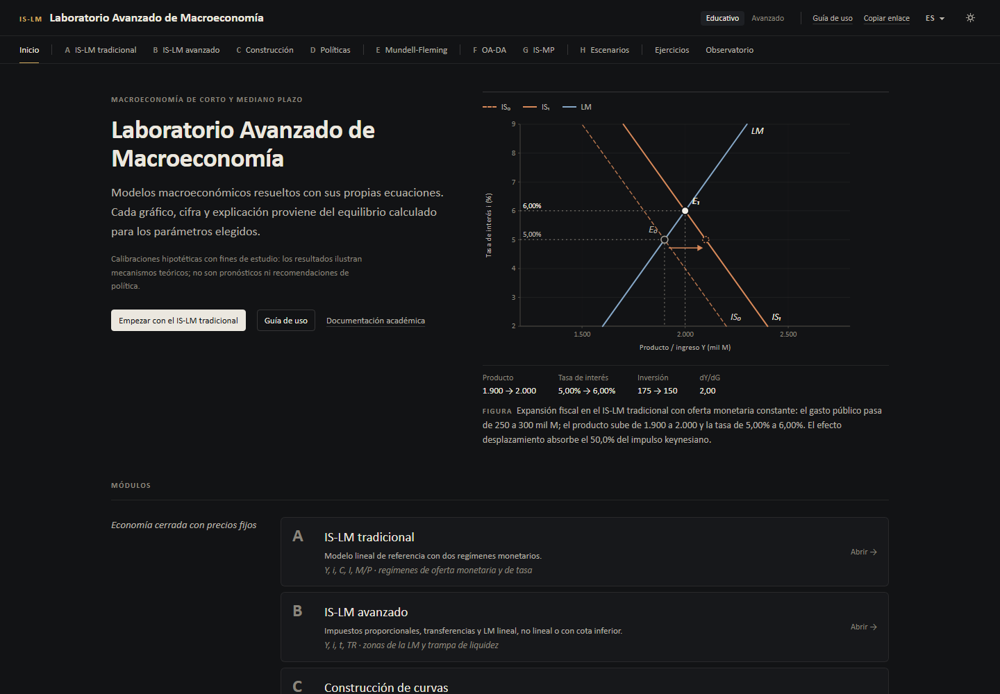

> **Teoría y evidencia.** Los módulos A–H resuelven **modelos de libro de texto
> con calibraciones hipotéticas**: ilustran mecanismos, no pronostican. El
> **Observatorio** muestra **datos publicados por organismos oficiales**. Vincular
> ambos es siempre una interpretación: que una variable se mueva después de una
> decisión no prueba que la decisión lo haya causado.

---

## Contenido

1. [Presentación](#1-presentación)
2. [Objetivos académicos](#2-objetivos-académicos)
3. [Enlace a la aplicación](#3-enlace-a-la-aplicación)
4. [Módulos disponibles](#4-módulos-disponibles)
5. [Cómo seleccionar un módulo](#5-cómo-seleccionar-un-módulo)
6. [Cómo modificar variables](#6-cómo-modificar-variables)
7. [Cómo ejecutar simulaciones](#7-cómo-ejecutar-simulaciones)
8. [Cómo interpretar los gráficos](#8-cómo-interpretar-los-gráficos)
9. [Cómo resolver ejercicios](#9-cómo-resolver-ejercicios)
10. [Cómo consultar datos históricos](#10-cómo-consultar-datos-históricos)
11. [Cómo interpretar los indicadores de cada país](#11-cómo-interpretar-los-indicadores-de-cada-país)
12. [Balanza comercial y sector externo](#12-balanza-comercial-y-sector-externo)
13. [Fuentes, noticias y acontecimientos](#13-fuentes-noticias-y-acontecimientos)
14. [De dónde provienen los datos](#14-de-dónde-provienen-los-datos)
15. [Frecuencia de actualización](#15-frecuencia-de-actualización)
16. [Limitaciones](#16-limitaciones)
17. [Instalación local](#17-instalación-local)
18. [Arquitectura](#18-arquitectura)
19. [Pruebas](#19-pruebas)
20. [Bibliografía](#20-bibliografía)

---

## 1. Presentación

El laboratorio reúne en una sola aplicación web:

- **Ocho módulos de teoría (A–H):** IS-LM lineal y no lineal, construcción
  gráfica de las curvas, políticas fiscal y monetaria, Mundell-Fleming, oferta y
  demanda agregada, IS-MP con curva de Phillips y regla de Taylor, y un
  laboratorio para comparar escenarios. Cada número, gráfico y explicación se
  calcula con las ecuaciones del modelo elegido.
- **Ejercicios y problemas** de nivel inicial, intermedio y avanzado, corregidos
  con los mismos motores de cálculo, con pistas, desarrollo matemático e
  interpretación económica.
- **Observatorio macroeconómico** con 50 series oficiales de Argentina y Estados
  Unidos (tasas, tipo de cambio, inflación, reservas, actividad, comercio
  exterior), 26 acontecimientos documentados con sus fuentes y una sección de
  noticias.
- **Guía de uso** paso a paso, que se abre en la primera visita y se puede volver
  a abrir desde «Guía de uso» en la barra superior.

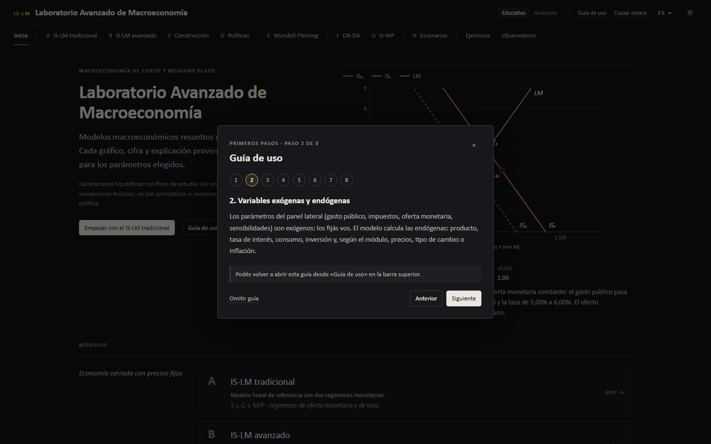

## 2. Objetivos académicos

- Entender cómo se determinan el producto, la tasa de interés, los precios y el
  tipo de cambio en los modelos macroeconómicos básicos.
- Distinguir variables **exógenas** (las fija el usuario o la política) de
  variables **endógenas** (las resuelve el equilibrio).
- Reconocer desplazamientos de curvas y movimientos a lo largo de ellas, y
  explicar los mecanismos de transmisión.
- Practicar el cálculo de equilibrios, multiplicadores y efectos desplazamiento.
- Contrastar los mecanismos teóricos con la experiencia argentina y
  estadounidense, distinguiendo **observaciones**, **hipótesis** e
  **interpretaciones**.

## 3. Enlace a la aplicación

**https://alanartola.github.io/islm-macroeconomic-simulator/**

No requiere registro ni instalación. Funciona en computadoras, tabletas y
teléfonos. Enlaces directos:

| Sección | Enlace |
|---|---|
| Inicio | [`/`](https://alanartola.github.io/islm-macroeconomic-simulator/) |
| A · IS-LM tradicional | [`?m=basic`](https://alanartola.github.io/islm-macroeconomic-simulator/?m=basic) |
| Ejercicios | [`?m=exercises`](https://alanartola.github.io/islm-macroeconomic-simulator/?m=exercises) |
| Observatorio | [`?m=observatory`](https://alanartola.github.io/islm-macroeconomic-simulator/?m=observatory) |
| Interfaz en inglés | [`?lang=en`](https://alanartola.github.io/islm-macroeconomic-simulator/?lang=en) |

## 4. Módulos disponibles

| | Módulo | Contenido | Documentación |
|---|---|---|---|
| A | **IS-LM tradicional** | Modelo lineal con oferta monetaria exógena u objetivo de tasa; transmisión, sensibilidad, escenarios y ecuaciones | [is-lm-tradicional](docs/modelos/is-lm-tradicional.md), [referencia](docs/MODELO.md) |
| B | **IS-LM avanzado** | Impuestos proporcionales, transferencias; LM lineal, no lineal (trampa de liquidez) o con cota inferior | [islm-avanzado](docs/modelos/islm-avanzado.md), [lm-no-lineal](docs/modelos/lm-no-lineal.md), [trampa-de-liquidez](docs/modelos/trampa-de-liquidez.md) |
| C | **Construcción de curvas** | Cruz keynesiana, formación de la IS y la LM, cuatro cuadrantes, mercado monetario | [cuatro-cuadrantes](docs/modelos/cuatro-cuadrantes.md) |
| D | **Políticas económicas** | Política fiscal y monetaria, combinaciones y sensibilidad de los multiplicadores | [politica-fiscal](docs/modelos/politica-fiscal.md), [politica-monetaria](docs/modelos/politica-monetaria.md), [multiplicadores](docs/modelos/multiplicadores.md) |
| E | **Mundell-Fleming** | Economía pequeña y abierta, movilidad perfecta de capitales, tipo de cambio fijo y flexible, reservas | [mundell-fleming](docs/modelos/mundell-fleming.md) |
| F | **Oferta y demanda agregada** | DA derivada del IS-LM, OA de corto plazo, mediano plazo y trayectoria de ajuste | [oa-da](docs/modelos/oa-da.md) |
| G | **IS-MP y política monetaria** | IS, curva de Phillips y regla de Taylor con cota inferior; tasa fija | [is-mp-taylor](docs/modelos/is-mp-taylor.md), [curva-de-phillips](docs/modelos/curva-de-phillips.md), [regla-de-taylor](docs/modelos/regla-de-taylor.md) |
| H | **Laboratorio de escenarios** | Guardar y comparar hasta cuatro escenarios; CSV, JSON, informe imprimible y enlaces | [escenarios](docs/modelos/escenarios.md), [sensibilidad](docs/modelos/sensibilidad.md) |
| — | **Ejercicios y problemas** | 20 ejercicios en tres niveles, con corrección automática y progreso local | [sección 9](#9-cómo-resolver-ejercicios) |
| — | **Observatorio macroeconómico** | Datos oficiales, historia económica, balanza comercial, noticias, fuentes | [secciones 10–15](#10-cómo-consultar-datos-históricos) |

## 5. Cómo seleccionar un módulo

- En pantallas anchas, la **barra de secciones** muestra los módulos agrupados
  por tema (economía cerrada, abierta, precios, comparación) y, al final,
  **Ejercicios** y **Observatorio**.
- En teléfonos, el botón **Módulo** abre la lista completa y **Parámetros**
  despliega el panel lateral.
- La pantalla de **Inicio** presenta cada módulo con una descripción y las
  variables que maneja.

## 6. Cómo modificar variables

El panel lateral de cada módulo está organizado en **bloques plegables**
(régimen, escenarios predefinidos, parámetros). Cada parámetro tiene un valor
**inicial** (escenario base, E₀) y un valor **final** (perturbación, E₁); se
modifica con el control deslizante o escribiendo el número. Los escenarios
predefinidos aplican con un clic políticas o shocks típicos.

El selector **Educativo / Avanzado** muestra solo las variables esenciales o
todos los parámetros, derivadas y diagnósticos.

## 7. Cómo ejecutar simulaciones

No hay botón de «calcular»: cada cambio se resuelve al instante. Para conservar
un resultado:

1. **Guardar experimento** lo envía al laboratorio de escenarios (Módulo H).
2. **Copiar enlace** genera una dirección que reproduce exactamente la
   configuración.
3. En el Módulo H se comparan hasta cuatro escenarios, con exportación a CSV,
   JSON, PNG, SVG e informe imprimible.

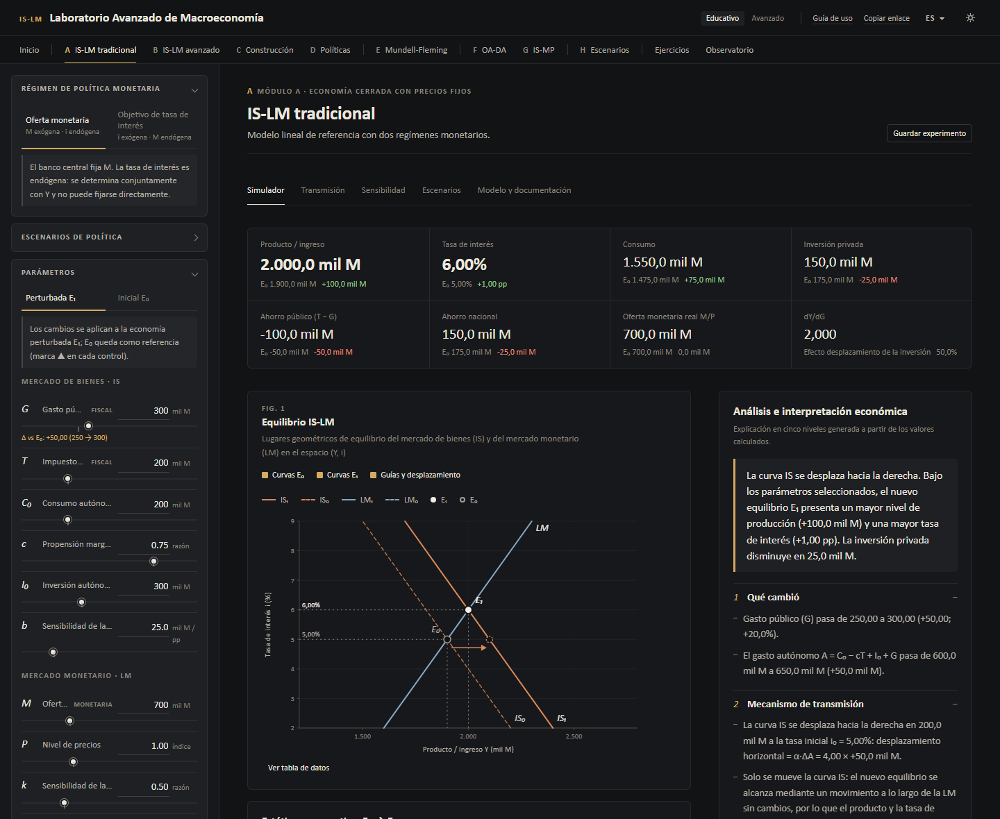

## 8. Cómo interpretar los gráficos

- **Trazo discontinuo:** curva inicial; **trazo continuo:** curva final.
- **E₀** es un anillo hueco y **E₁** un punto sólido; la flecha une dos
  equilibrios estáticos (no es una trayectoria temporal, salvo en el Módulo F).
- **Colores con significado económico**, iguales en todos los módulos: cobre
  para la demanda y el mercado de bienes (IS, DA), acero para el mercado
  monetario y la política monetaria (LM, MP), ciruela para la oferta y los
  precios, oliva para el sector externo, gris para las referencias.
- La explicación en cinco niveles (qué cambió, transmisión, equilibrio,
  matemática, interpretación) distingue resultados del modelo, interpretaciones
  teóricas y advertencias.

En el Observatorio, los gráficos temporales usan **paneles sincronizados por
fecha**, uno por unidad: nunca se dibujan en un mismo eje variables con unidades
distintas.

## 9. Cómo resolver ejercicios

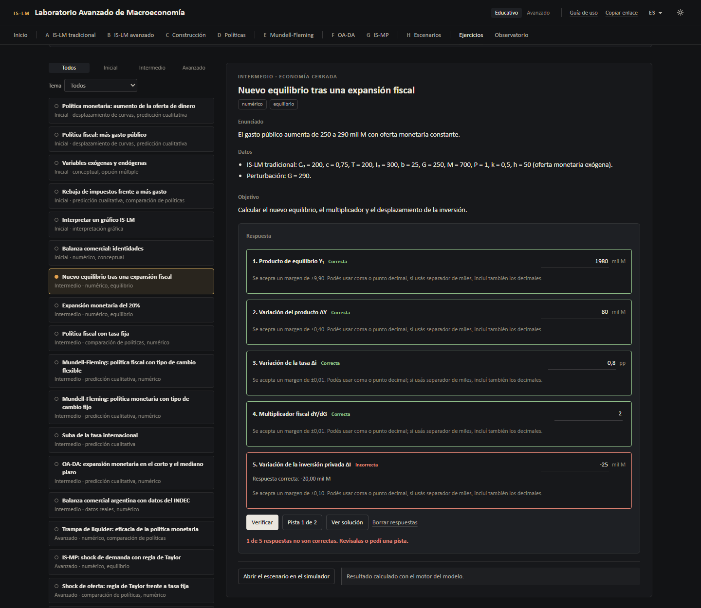

Cada ejercicio incluye **enunciado, datos, objetivo, espacio de respuesta,
pistas opcionales, verificación, resultado correcto, desarrollo matemático,
interpretación económica** y, cuando corresponde, un botón para **abrir el
escenario en el simulador** o **ver los datos en el observatorio**.

| Nivel | Ejercicios |
|---|---|
| **Inicial (6)** | Expansión monetaria del 10% (curva, dirección, tasa, inversión, producto) · Más gasto público · Variables exógenas y endógenas · Rebaja de impuestos frente a más gasto · Interpretar un gráfico IS-LM · Identidades de la balanza comercial |
| **Intermedio (8)** | Nuevo equilibrio tras ΔG = 40 (Y₁, ΔY, Δi, multiplicador, ΔI) · Expansión monetaria del 20% · Política fiscal con tasa fija · Mundell-Fleming: fiscal con tipo flexible · Mundell-Fleming: monetaria con tipo fijo · Suba de la tasa internacional · OA-DA en el corto y el mediano plazo · Balanza comercial argentina con datos del INDEC |
| **Avanzado (6)** | Trampa de liquidez · IS-MP: shock de demanda con regla de Taylor · Shock de oferta: regla frente a tasa fija · Cota inferior de la tasa · Argentina, agosto de 2018 (tasa de 60%) · Argentina, agosto de 2023 (devaluación e inflación) |

- **Tipos:** conceptual, opción múltiple, numérico, interpretación gráfica,
  desplazamiento de curvas, predicción cualitativa, equilibrio, comparación de
  políticas, análisis histórico y datos reales.
- **Corrección:** las respuestas numéricas se comparan con el resultado del motor
  del modelo, con un margen de tolerancia indicado; se aceptan coma o punto
  decimal. El valor correcto se muestra al abrir la solución.
- **Ejercicios con datos reales:** usan las series oficiales publicadas en el
  observatorio y piden clasificar afirmaciones como **observación**,
  **hipótesis** o **interpretación**.
- **Progreso:** realizados, resueltos, respuestas erróneas y avance por nivel. Se
  guarda **solo en el navegador** (no se envía a ningún servidor) y se puede
  reiniciar.

## 10. Cómo consultar datos históricos

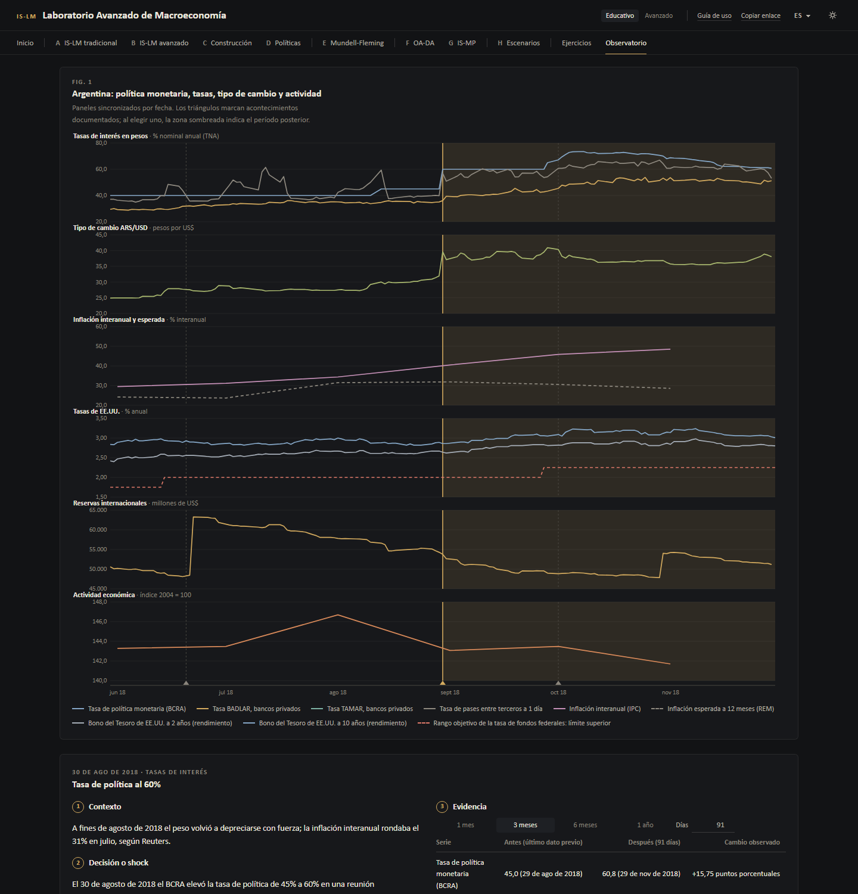

En **Observatorio → Tasas, tipo de cambio y actividad**:

1. **Variables:** mostrar u ocultar tasas en pesos, tipo de cambio ARS/USD,
   inflación interanual y esperada, inflación mensual, tasas de EE.UU., reservas,
   actividad, tipo de cambio real y base monetaria.
2. **Transformación:** valores originales, variación interanual, índice base 100
   o diferencia (en puntos porcentuales para las tasas). Las tasas y los saldos
   que cambian de signo no admiten variaciones porcentuales ni índices.
3. **Ventana:** 1 mes, 3 meses, 6 meses, 1 año, 5 años, todo o fechas a elección.
4. **Acontecimiento:** al elegir uno, el gráfico se centra en esa fecha, sombrea
   el período posterior y abre la ficha del episodio.

En **Historia económica** cada episodio se presenta en cuatro partes:
**① Contexto · ② Decisión o shock · ③ Evidencia · ④ Interpretación**. La
evidencia es una tabla de valores publicados antes y después de la fecha (1 mes,
3 meses, 6 meses, 1 año o los días que se elijan); si la ventana todavía no
transcurrió, se indica. Las hipótesis se rotulan como tales.

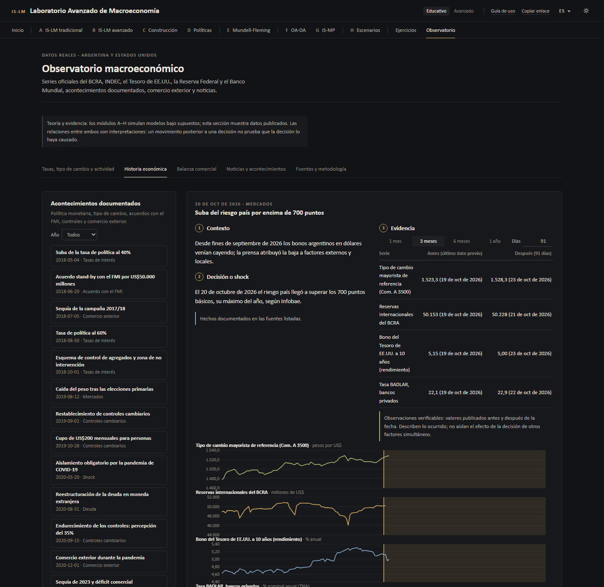

**Episodios documentados (21):** suba de la tasa al 40% (05/2018) · acuerdo
stand-by con el FMI (06/2018) · tasa al 60% (08/2018) · control de agregados y
zona de no intervención (10/2018) · caída del peso tras las PASO (08/2019) ·
controles cambiarios (09/2019) · cupo de US$200 (10/2019) · aislamiento por
COVID-19 (03/2020) · reestructuración de deuda (08/2020) · percepción del 35%
(09/2020) · devaluación y tasa de 118% (08/2023) · devaluación a 800 pesos
(12/2023) · pases pasivos como tasa de política (12/2023) · recortes de tasa
(05/2024) · nuevo acuerdo con el FMI y bandas cambiarias (04/2025) · fin de las
LEFI (07/2025) · acuerdo con el Tesoro de EE.UU. (10/2025) · elecciones
legislativas (10/2025) · bandas indexadas por inflación (01/2026) · segunda
revisión del FMI (05/2026) · riesgo país por encima de 700 puntos (10/2026).
Además, cinco hitos de comercio exterior (sección 12).

**¿Qué ocurrió en Argentina cuando aumentaron las tasas de interés?** En los
datos publicados por el BCRA, tras la suba al 40% (4/5/2018) el tipo de cambio
mayorista pasó de 21,75 a 24,96 pesos por dólar en 30 días (+14,8%) y las
reservas cayeron 5.934 millones de US$; tras la suba al 60% (30/8/2018), de
31,94 a 40,90 (+28,0%), con una caída de reservas de 5.300 millones. Esa
coincidencia **no** permite concluir que la tasa no funcionó ni
que funcionó: en esos meses cambiaron a la vez las expectativas de devaluación,
el riesgo soberano, el acceso al financiamiento externo, la sequía, el acuerdo
con el FMI y la credibilidad del esquema monetario. Las fichas presentan esos
factores como hipótesis, con sus fuentes.

## 11. Cómo interpretar los indicadores de cada país

- **Argentina** es el foco del observatorio; **Estados Unidos** funciona como
  referencia por su influencia sobre el costo del financiamiento internacional.
  Solo se incluyen países con series oficiales de cobertura suficiente.
- **Tasas de EE.UU.:** el **rango objetivo de la Reserva Federal** (decisión de
  política) se muestra separado de los **rendimientos de los bonos del Tesoro**
  (precios de mercado).
- **Comparación Argentina–EE.UU.:** las tasas en pesos y en dólares se dibujan en
  paneles distintos. No son rendimientos equivalentes: para compararlas hay que
  considerar la depreciación esperada del peso, la inflación esperada, el riesgo
  soberano, la prima por riesgo, la moneda de denominación y las restricciones
  cambiarias. La diferencia de tasas **no** es el riesgo país (que se mide con
  el diferencial de bonos soberanos en dólares).
- **Nominal y real:** cada serie indica su unidad (% nominal anual, % mensual,
  pesos por dólar, índice, millones de US$). El tipo de cambio se expresa en
  pesos por dólar: un número mayor es un peso más débil.

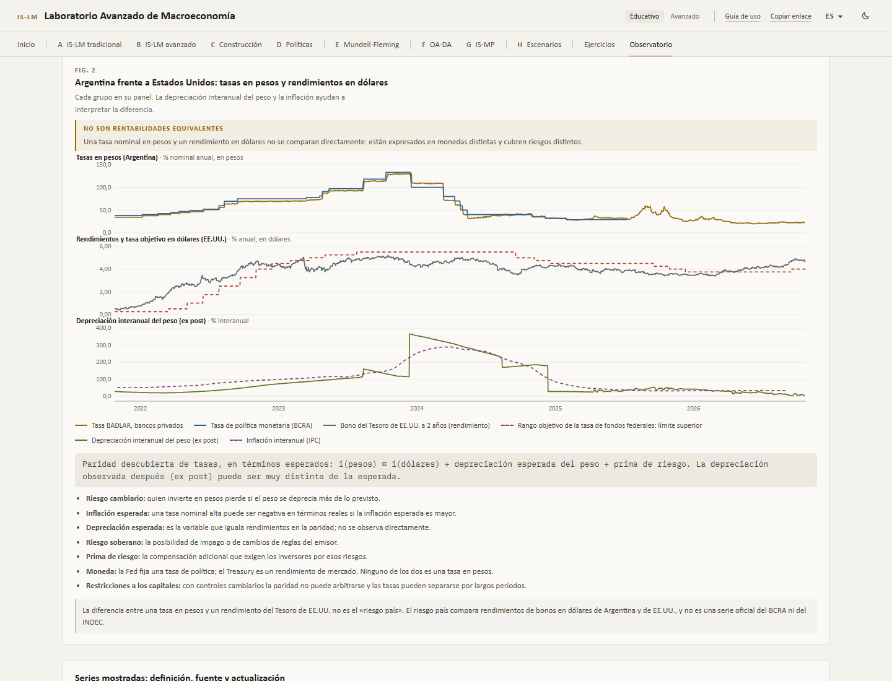

## 12. Balanza comercial y sector externo

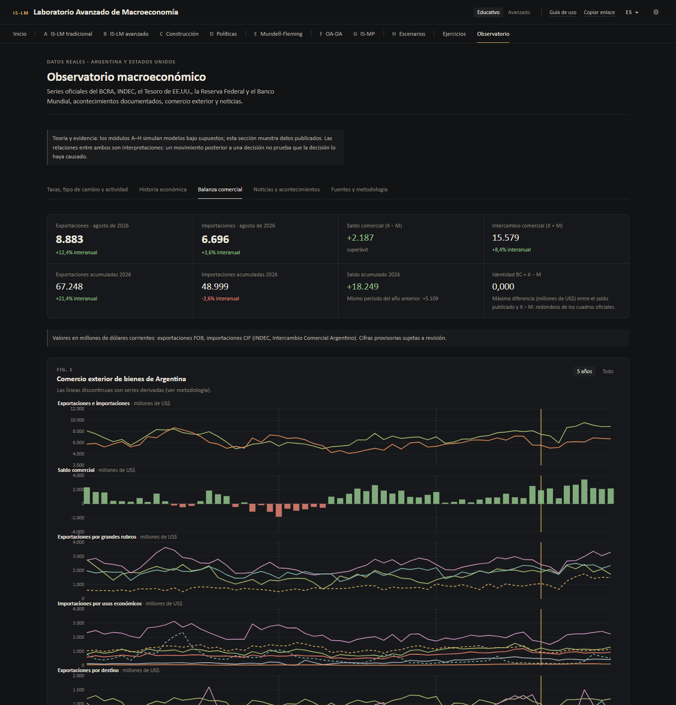

Con el **Intercambio Comercial Argentino (INDEC)**:

- **Indicadores:** exportaciones (X, FOB), importaciones (M, CIF), saldo
  **BC = X − M**, intercambio **IC = X + M**, variación interanual, acumulado del
  año y comparación con el mismo período del año anterior.
- **Verificación de identidades:** el saldo publicado se compara con X − M en cada
  mes; la diferencia máxima se informa (en la publicación actual, 0,000 millones
  de US$). Los grandes rubros de exportación y los usos económicos de
  importación suman los totales.
- **Gráficos:** exportaciones e importaciones, saldo (barras de superávit y
  déficit), exportaciones por grandes rubros, importaciones por usos económicos,
  socios comerciales, composición por año y comparación entre dos años.
- **Preguntas guiadas:** por qué cambian las exportaciones y las importaciones, y
  por qué **un superávit no implica necesariamente más bienestar** (puede
  reflejar importaciones deprimidas por una recesión).
- **Balanza comercial y balanza de pagos:** la primera mide solo bienes; la
  segunda incluye servicios, rentas, transferencias, la cuenta financiera y la
  variación de reservas.
- **Hitos documentados:** sequía 2017/18, pandemia, sequía de 2023, superávit
  récord de 2024, repunte de importaciones en 2025.

Algunas series de rubros y socios no tienen datos en la API oficial; en esos
casos se calculan a partir de identidades publicadas y se rotulan **«derivado»**
con su fórmula (por ejemplo, combustibles y energía = exportaciones totales −
productos primarios − MOA − MOI).

## 13. Fuentes, noticias y acontecimientos

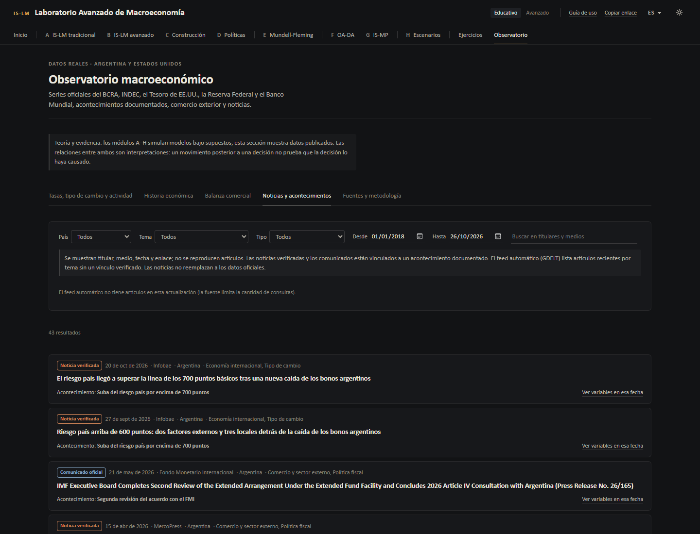

- **Noticias curadas y comunicados oficiales:** titular, medio, fecha, enlace,
  tema, país y acontecimiento relacionado. No se reproducen artículos completos.
  «Ver variables en esa fecha» abre el gráfico centrado en ese día.
- **Filtros:** país, tema, origen (oficial, curada, automática), fechas y texto.
- **Noticias automáticas:** se consultan a la API pública de GDELT en cada
  actualización. El servicio limita la frecuencia de consulta; si no responde,
  la sección lo indica y se muestran solo las noticias curadas. Las automáticas
  no se vinculan a acontecimientos sin verificación.
- **Prioridad de fuentes:** estadísticas oficiales → comunicados oficiales →
  organismos internacionales → medios → fuentes secundarias.
- Todos los titulares, fechas y enlaces de los episodios fueron verificados; las
  fechas que no pudieron confirmarse se dejan vacías en lugar de estimarse.

## 14. De dónde provienen los datos

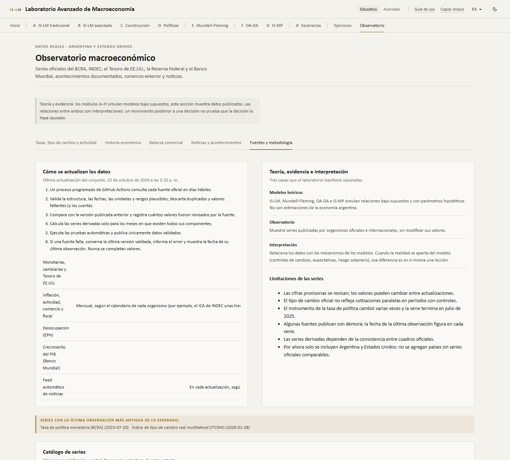

Cada serie tiene en la aplicación su ficha: **nombre exacto, definición, unidad,
frecuencia, cobertura, organismo, canal de descarga, identificador, fecha de la
última observación, fecha de descarga, carácter original o derivado y
metodología**.

| Organismo | Canal | Series |
|---|---|---|
| **Banco Central de la República Argentina** | API Estadísticas Monetarias v4.0 | Tasa de política (id 160, finalizada el 10/07/2025), BADLAR privados (7), TAMAR privados (44), pases entre terceros a 1 día (150), tipo de cambio mayorista Com. A 3500 (5), reservas internacionales (1), base monetaria (15), M2 (109), inflación mensual (27), inflación interanual (28), inflación esperada REM a 12 meses (29) |
| **BCRA** | Series de Tiempo de datos.gob.ar | Índice de tipo de cambio real multilateral, diario (116.4_TCRZE_2015_D_36_4) |
| **INDEC** | Series de Tiempo de datos.gob.ar | IPC nacional (148.3_INIVELNAL_DICI_M_26), EMAE desestacionalizado y original, desocupación EPH, exportaciones e importaciones totales, saldo, rubros, usos económicos y socios comerciales |
| **Secretaría de Hacienda** | Series de Tiempo de datos.gob.ar | Resultado primario del Sector Público Nacional |
| **Departamento del Tesoro de EE.UU.** | Daily Treasury Par Yield Curve (CSV) | Rendimientos a 3 meses, 2 años y 10 años |
| **Reserva Federal** | FRED (Fed. de St. Louis) | Rango objetivo de la tasa de fondos federales (DFEDTARU, DFEDTARL) |
| **Bureau of Labor Statistics** | FRED | IPC de EE.UU. (CPIAUCSL), desempleo (UNRATE) |
| **Banco Mundial** | API v2 | Crecimiento del PIB real de Argentina y EE.UU. (NY.GDP.MKTP.KD.ZG) |

**Cobertura:** desde enero de 2016 para las series mensuales y diarias (TAMAR
desde octubre de 2024, IPC nacional desde diciembre de 2016) y desde 2000 para
las anuales. **Total:** 46 series descargadas y 4 derivadas.

**Notas metodológicas verificadas con los datos:**

- Las series mensuales del BCRA vienen fechadas a fin de mes; se normalizan al
  primer día del mes para alinearlas con las del INDEC.
- La inflación mensual del BCRA coincide con el IPC del Gran Buenos Aires hasta
  mayo de 2017 y con el IPC nacional desde junio de 2017.
- Las series de socios comerciales se publican rotuladas en dólares, pero sus
  magnitudes son millones de US$, igual que los totales.
- El ITCRM diario y el rango de la Reserva Federal se publican para todos los
  días calendario; el resto de las series diarias, solo en días hábiles.

**Estado de cada serie:** *actualizada*, *desactualizada* (el último dato supera
el rezago habitual de publicación: 10 días para series diarias, 95 para
mensuales, 200 para trimestrales y 560 para anuales, contados desde el fin del
período) o *versión anterior* (la descarga falló y se conserva la última versión
validada). En la publicación actual figuran como desactualizadas la tasa de
política del BCRA (discontinuada en julio de 2025) y el ITCRM diario (último dato
publicado: 28/01/2026).

## 15. Frecuencia de actualización

La actualización corre en **GitHub Actions** (`.github/workflows/ci-deploy.yml`):

| Disparador | Qué hace |
|---|---|
| Días hábiles, 22:30 UTC (19:30 en Buenos Aires) | Descarga todas las series y las noticias, valida, prueba, compila y publica |
| Cada cambio en `main` | Igual que el anterior |
| Ramas `feature/**` y pull requests | Prueba con la copia de los datos guardada en el repositorio, sin publicar |

Flujo de cada actualización:

1. **Consulta** a cada fuente oficial (con reintentos).
2. **Validación** de estructura, fechas, unidades y rangos plausibles.
3. **Duplicados** eliminados y **valores faltantes** descartados (se cuentan).
4. **Revisiones** detectadas contra la versión publicada anterior.
5. **Transformaciones** (series derivadas) y verificación de identidades.
6. **Registro** de fecha de descarga, estado y errores en `manifest.json`.
7. **Pruebas** automáticas sobre los datos nuevos.
8. **Publicación** solo si todo se aprueba.

Si una fuente falla o entrega datos que no validan, se conserva la **última
versión validada** (leída del sitio publicado) marcada como «versión anterior»
con el error. Si las pruebas fallan, el sitio no se actualiza. El registro de cada
corrida queda como artefacto del workflow durante 30 días. Las series diarias
cambian cada día hábil; las mensuales, cuando el organismo publica el dato nuevo.

## 16. Limitaciones

**Modelos**

- Modelos **estáticos**: comparan equilibrios; solo el Módulo F incluye una
  trayectoria, con expectativas adaptativas simples.
- Precios fijos en A–E; expectativas exógenas en F (corto plazo) y G.
- Mundell-Fleming solo con movilidad perfecta de capitales, sin prima de riesgo
  ni efectos de balance, supuestos poco adecuados para una economía con deuda en
  dólares y controles cambiarios como la argentina.
- Calibraciones hipotéticas; los resultados son ilustraciones, no predicciones.

**Datos**

- Las cifras oficiales se revisan; la aplicación muestra la última versión
  publicada y cuenta las revisiones.
- Durante los períodos con controles cambiarios coexistieron varios tipos de
  cambio; el observatorio usa el **oficial mayorista** (Com. A 3500), no las
  cotizaciones paralelas, que no tienen una fuente oficial.
- La tasa de política del BCRA cambió de instrumento varias veces (LEBAC, LELIQ,
  pases pasivos, LEFI) y la serie se discontinuó en julio de 2025.
- Las tablas de evidencia describen valores antes y después de una fecha; no
  aíslan el efecto de una decisión.
- Las noticias automáticas dependen de un servicio externo con límites de uso.

**Pendiente o propuesto (no implementado):** movilidad imperfecta de capitales
(BP con pendiente), riesgo país como serie (no hay una fuente oficial con API
abierta), tipos de cambio paralelos, balanza de pagos completa y más países con
cobertura oficial comparable.

## 17. Instalación local

Requisitos: Node.js 24 (o ≥ 22.18) y npm.

```bash
git clone https://github.com/alanartola/islm-macroeconomic-simulator.git
cd islm-macroeconomic-simulator
npm ci
npm run dev
```

| Comando | Función |
|---|---|
| `npm run dev` | servidor de desarrollo |
| `npm test` | pruebas de modelos, datos, ejercicios e interfaz |
| `npm run typecheck` / `npm run lint` | verificaciones estáticas |
| `npm run build` | compilación de producción en `dist/` (ruta base `/islm-macroeconomic-simulator/`) |
| `npm run validate` | typecheck + lint + pruebas + build |
| `node scripts/data/fetch.ts` | descarga y valida los datos oficiales en `public/data` |
| `node scripts/screenshots.mjs http://localhost:5173/` | regenera las capturas desde el servidor de desarrollo |

`fetch.ts` acepta `--only id,id` (algunas series), `--no-news` y
`--fallback-url URL` (versión publicada a conservar si una fuente falla).

## 18. Arquitectura

```
src/
├── engine/              motores económicos puros (sin React): A, B (advanced), E (open), F (adas), G (ismp), métodos numéricos
├── interpretation/      explicaciones en cinco niveles
├── lab/                 escenarios: validación, indicadores comparables, CSV/JSON, enlaces
├── exercises/           banco de ejercicios (respuestas calculadas con los motores), corrección y progreso
├── data/                tipos, validación, transformaciones e identidades (core.ts); lectores de cada fuente (parsers.ts); carga en el navegador (client.ts)
├── observatory/         vistas del observatorio y acontecimientos documentados con fuentes (episodes.ts)
├── modules/             vistas de los módulos A–H y la pantalla de inicio
├── components/          gráficos SVG, guía de uso, paneles laterales plegables, barra superior
├── i18n/                diccionarios ES (principal) y EN con paridad verificada
└── styles/              tokens de diseño: oscuro predeterminado, claro, impresión
scripts/data/            catálogo de series (catalog.ts), descarga (fetch.ts) y pruebas de datos
public/data/             series validadas (JSON), manifest.json y noticias
```

- **Tecnologías:** React 19, TypeScript estricto, Vite 7, d3-scale / d3-shape,
  KaTeX, Vitest + Testing Library, ESLint, GitHub Actions, GitHub Pages.
- **Sin servidor propio:** la aplicación es estática; los datos se descargan en
  GitHub Actions y se publican como archivos JSON junto al sitio.
- **Diseño:** tipografía **Aptos** (segunda opción Calibri; luego Segoe UI y
  Arial) en toda la interfaz, sin serifas; cifras tabulares; IBM Plex Mono solo
  en los bloques de fórmulas. Paneles delimitados, opciones en bloques
  plegables, modo oscuro grafito predeterminado y modo claro propio. Detalle del
  sistema visual: [docs/rediseno](docs/rediseno/README.md).
- **Idioma y tema:** español y modo oscuro en toda primera visita; el inglés
  (`?lang=en`) y el tema claro (`?theme=light`) se eligen en la barra superior y
  se recuerdan.

## 19. Pruebas

456 pruebas automáticas (Vitest), que se ejecutan en cada cambio y antes de cada
publicación:

- **Modelos:** soluciones calculadas a mano, identidades contables, derivadas
  analíticas frente a diferencias finitas, casos límite (trampa de liquidez, cota
  inferior, reservas agotadas).
- **Datos — procesamiento:** lectores de cada fuente con respuestas de ejemplo
  (BCRA, datos.gob.ar, Tesoro, FRED, Banco Mundial), fechas inválidas, valores
  fuera de rango por unidad, duplicados, faltantes, revisiones, errores de
  descarga con conservación de la versión anterior, rezagos por frecuencia,
  variaciones interanuales, diferencias en puntos porcentuales, índice base 100,
  conversión TNA → TEA, agregación mensual y ventanas incompletas.
- **Datos — publicación actual:** cada archivo valida; metadatos iguales al
  catálogo; fechas según la frecuencia; estado coherente con la regla de
  rezago; `manifest.json` consistente; saldo publicado = X − M; rubros y usos
  suman los totales; series derivadas reproducen su fórmula; socios ≤ total;
  tipo de cambio en pesos por dólar; rango de la Reserva Federal de 25 puntos
  básicos; tasas en porcentaje; inflación mensual coherente con el IPC.
- **Acontecimientos y noticias:** fechas ISO, enlaces https, sin duplicados,
  orden cronológico, ningún episodio en el futuro, las cuatro partes completas.
- **Ejercicios:** respuestas iguales a las soluciones cerradas (por ejemplo,
  ΔG = 40 → Y₁ = 1.980, Δi = 0,8 pp, multiplicador 2, ΔI = −20), escenarios
  válidos, ejercicios con datos construidos con la serie oficial y sin inventar
  valores si falta una serie, lectura de números en notación española e
  inglesa, progreso local.
- **Interfaz:** navegación, guía de uso (primera visita, omitir, reabrir),
  corrección de un ejercicio de punta a punta, pestañas del observatorio con los
  datos publicados, aviso cuando falta una serie, español y modo oscuro por
  defecto.

## 20. Bibliografía

Referencias con DOI verificadas contra Crossref; Friedman (1968) no tiene DOI.
Lista completa en [docs/modelos](docs/modelos/README.md#bibliografía-verificada).

- Blanchard, O. (2021). *Macroeconomics* (8.ª ed.). Pearson.
- Brent, R. P. (1973). *Algorithms for Minimization without Derivatives*. Prentice-Hall.
- Carlin, W., y Soskice, D. (2015). *Macroeconomics: Institutions, Instability, and the Financial System*. Oxford University Press.
- Clarida, R., Galí, J., y Gertler, M. (1999). The Science of Monetary Policy: A New Keynesian Perspective. *Journal of Economic Literature*, 37(4), 1661–1707. https://doi.org/10.1257/jel.37.4.1661
- Fleming, J. M. (1962). Domestic Financial Policies under Fixed and under Floating Exchange Rates. *IMF Staff Papers*, 9(3), 369–380. https://doi.org/10.2307/3866091
- Friedman, M. (1968). The Role of Monetary Policy. *American Economic Review*, 58(1), 1–17.
- Hicks, J. R. (1937). Mr. Keynes and the "Classics"; A Suggested Interpretation. *Econometrica*, 5(2), 147–159. https://doi.org/10.2307/1907242
- Keynes, J. M. (1936). *The General Theory of Employment, Interest and Money*. Macmillan.
- Krugman, P. R. (1998). It's Baaack: Japan's Slump and the Return of the Liquidity Trap. *Brookings Papers on Economic Activity*, 1998(2), 137–205. https://doi.org/10.2307/2534694
- Mankiw, N. G. (2019). *Macroeconomics* (10.ª ed.). Worth Publishers.
- Mundell, R. A. (1963). Capital Mobility and Stabilization Policy under Fixed and Flexible Exchange Rates. *Canadian Journal of Economics and Political Science*, 29(4), 475–485. https://doi.org/10.2307/139336
- Phelps, E. S. (1967). Phillips Curves, Expectations of Inflation and Optimal Unemployment over Time. *Economica*, 34(135), 254–281. https://doi.org/10.2307/2552025
- Phillips, A. W. (1958). The Relation between Unemployment and the Rate of Change of Money Wage Rates in the United Kingdom, 1861–1957. *Economica*, 25(100), 283–299. https://doi.org/10.1111/j.1468-0335.1958.tb00003.x
- Poole, W. (1970). Optimal Choice of Monetary Policy Instruments in a Simple Stochastic Macro Model. *Quarterly Journal of Economics*, 84(2), 197–216. https://doi.org/10.2307/1883009
- Romer, D. (2000). Keynesian Macroeconomics without the LM Curve. *Journal of Economic Perspectives*, 14(2), 149–169. https://doi.org/10.1257/jep.14.2.149
- Taylor, J. B. (1993). Discretion versus Policy Rules in Practice. *Carnegie-Rochester Conference Series on Public Policy*, 39, 195–214. https://doi.org/10.1016/0167-2231(93)90009-L

**Fuentes de datos:** BCRA, [API de Estadísticas](https://www.bcra.gob.ar/apis-banco-central/) ·
INDEC, [Intercambio Comercial Argentino](https://www.indec.gob.ar/indec/web/Nivel4-Tema-3-2-40) ·
[Series de Tiempo de Argentina](https://datos.gob.ar/series) ·
U.S. Treasury, [Daily Treasury Par Yield Curve Rates](https://home.treasury.gov/resource-center/data-chart-center/interest-rates/TextView?type=daily_treasury_yield_curve) ·
Federal Reserve Bank of St. Louis, [FRED](https://fred.stlouisfed.org/) ·
[Banco Mundial](https://data.worldbank.org/) · [GDELT](https://www.gdeltproject.org/).

<p align="center">
  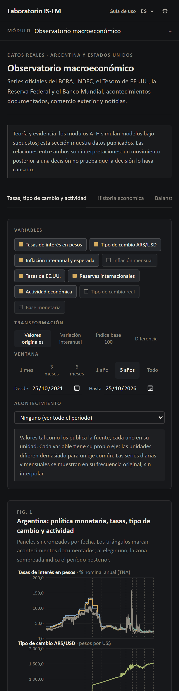
  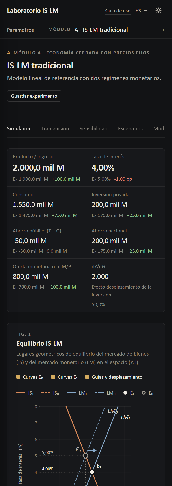
</p>

## Licencia

[MIT](LICENSE)
