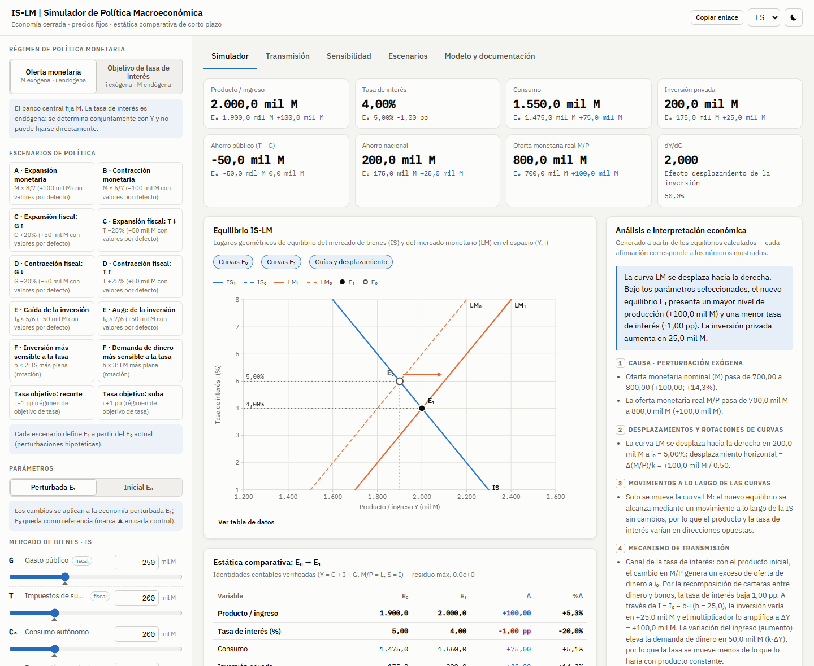
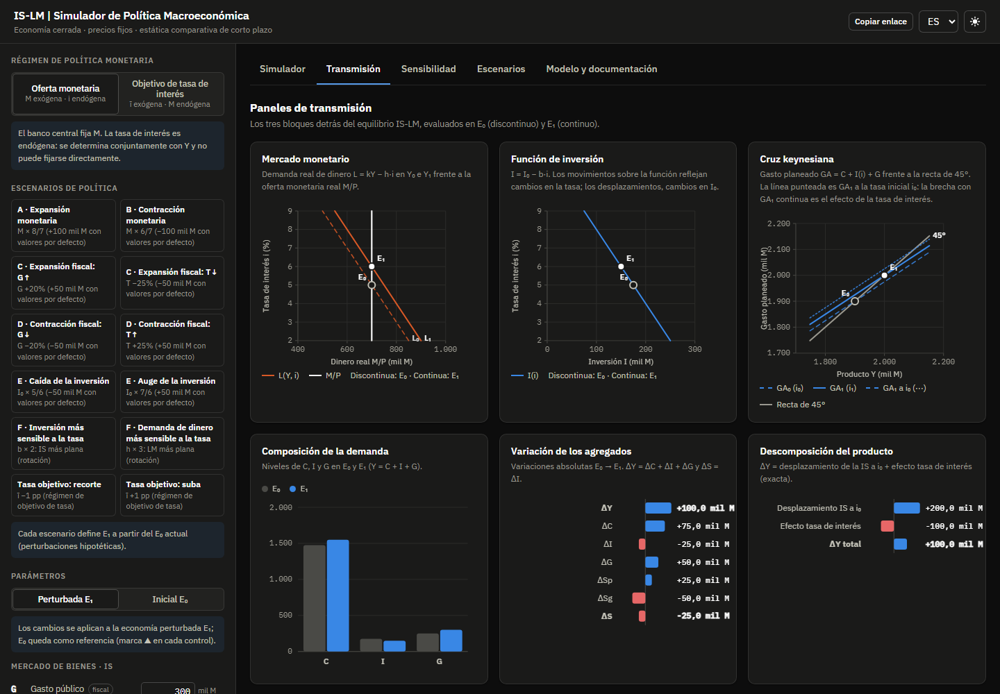
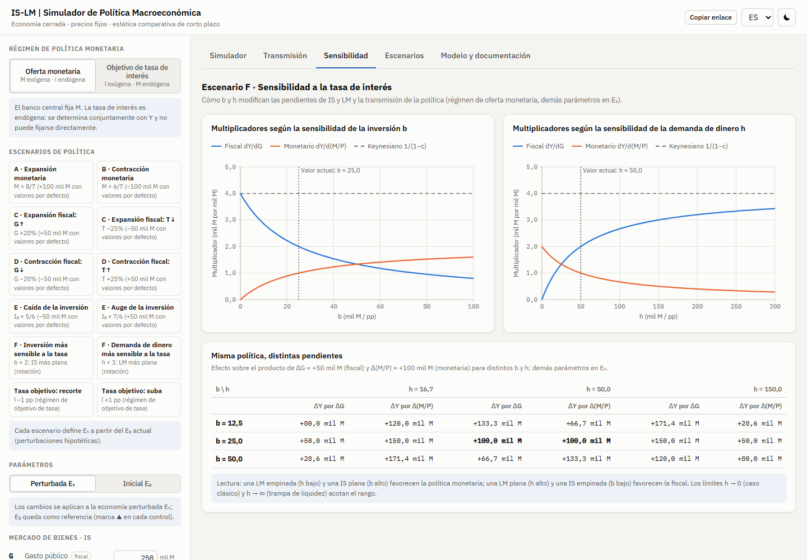
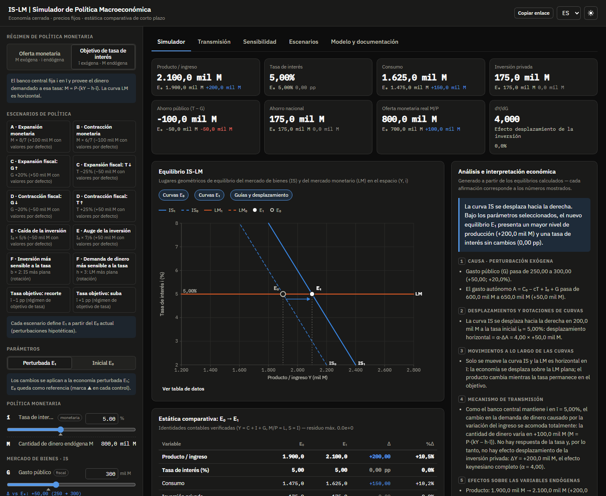
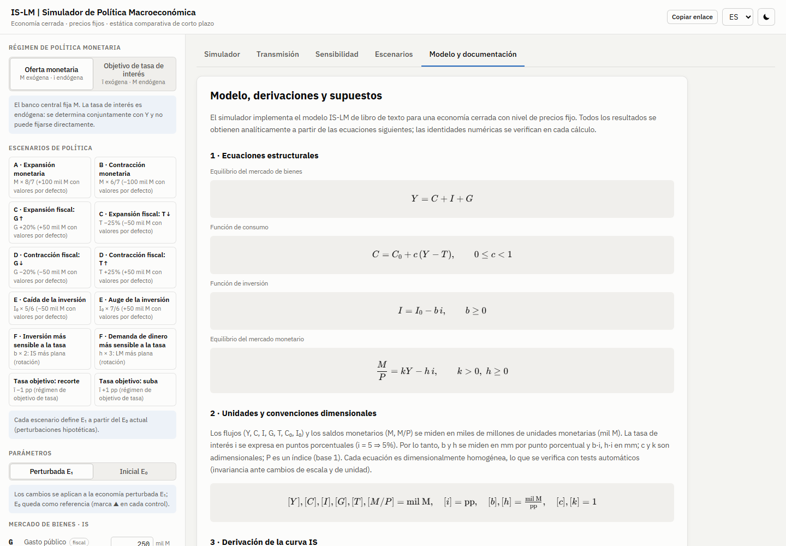
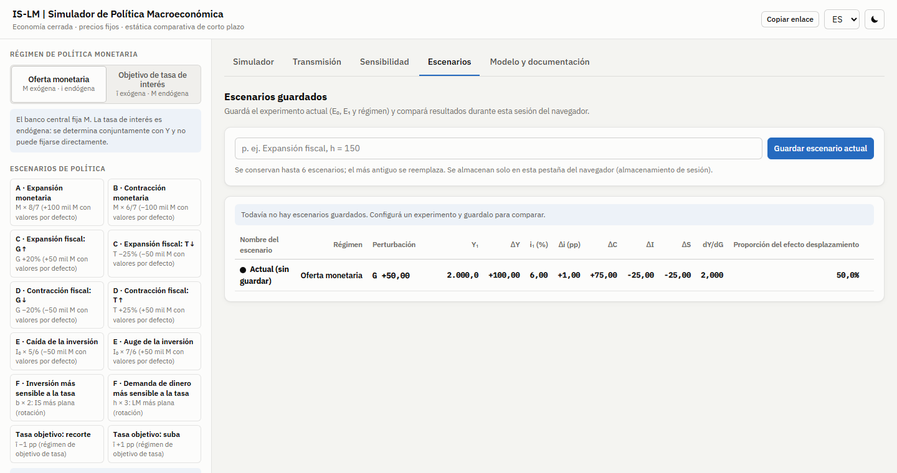

# IS-LM | Simulador de Política Macroeconómica

Plataforma interactiva de simulación macroeconómica para explorar el equilibrio IS-LM, la transmisión de las políticas monetaria y fiscal, la dinámica de la tasa de interés y la estática comparativa mediante modelización matemática y visualizaciones en tiempo real.

**Aplicación publicada:** https://alanartola.github.io/islm-macroeconomic-simulator/ (se abre en español; el inglés está disponible en el selector de idioma)
 · **Referencia del modelo:** [docs/MODELO.md](docs/MODELO.md)
 · **English version:** [docs/README.en.md](docs/README.en.md)

[](https://github.com/alanartola/islm-macroeconomic-simulator/actions/workflows/ci-deploy.yml)


> **Alcance.** La aplicación implementa el modelo IS-LM de corto plazo de libro de texto para una economía cerrada con nivel de precios fijo. Los valores por defecto son una **calibración hipotética** elegida por claridad pedagógica. La herramienta ilustra estática comparativa; **no** es un sistema de predicción de ninguna economía real.

---

## Contenido

1. [Qué hace la aplicación](#qué-hace-la-aplicación)
2. [El modelo](#el-modelo)
3. [Regímenes de política monetaria](#regímenes-de-política-monetaria)
4. [Funcionalidades](#funcionalidades)
5. [Capturas](#capturas)
6. [Ejemplos de simulación](#ejemplos-de-simulación)
7. [Arquitectura](#arquitectura)
8. [Instalación y ejecución local](#instalación-y-ejecución-local)
9. [Validaciones y pruebas](#validaciones-y-pruebas)
10. [Limitaciones](#limitaciones)
11. [Bibliografía](#bibliografía)

---

## Qué hace la aplicación

El simulador compara dos equilibrios de la misma economía:

- **E₀ — economía inicial**, definida por un conjunto de parámetros exógenos;
- **E₁ — economía perturbada**, que resulta de modificar uno o más parámetros (una política económica o una perturbación de comportamiento).

Ante cada cambio recalcula, de forma analítica e instantánea, la tasa de interés, el producto, el consumo, la inversión, el gasto público, la recaudación impositiva, el ingreso disponible, la oferta y la demanda reales de dinero, el ahorro privado, público y nacional, los multiplicadores de política, los desplazamientos de ambas curvas y las variaciones absolutas y porcentuales. La sección **Análisis e interpretación económica** explica luego el resultado —distinguiendo *causas*, *desplazamientos de curvas*, *movimientos a lo largo de las curvas*, *mecanismos de transmisión* y *efectos sobre las variables endógenas*— utilizando exclusivamente los valores efectivamente calculados.

## El modelo

### Ecuaciones estructurales

| Bloque | Ecuación | Restricciones |
|---|---|---|
| Equilibrio del mercado de bienes | Y = C + I + G | — |
| Consumo | C = C₀ + c(Y − T) | 0 ≤ c < 1 |
| Inversión | I = I₀ − b·i | b ≥ 0 |
| Equilibrio del mercado monetario | M/P = kY − h·i | k > 0, h ≥ 0, P > 0 |

### Convenciones dimensionales

Los flujos (Y, C, I, G, T, C₀, I₀) y el dinero (M, M/P) se miden en **miles de millones de unidades monetarias (mil M)**; la **tasa de interés i se expresa en puntos porcentuales** (i = 5 ⇒ 5%); por lo tanto, **b y h se miden en mil M por punto porcentual**, c y k son adimensionales y P es un índice (base 1). Cada ecuación es dimensionalmente homogénea; las pruebas automáticas verifican la invariancia ante cambios de escala y ante el cambio de unidad de la tasa (pp → decimal, con b y h × 100).

### Curvas IS y LM

Con el gasto autónomo **A ≡ C₀ − cT + I₀ + G**, el multiplicador simple **α ≡ 1/(1 − c)** y los saldos reales **m ≡ M/P**:

```
IS:  Y = α (A − b·i)        ⇔  i = [A − (1 − c) Y] / b        pendiente di/dY = −(1 − c)/b
LM:  Y = (m + h·i) / k      ⇔  i = (kY − m) / h               pendiente di/dY =  k/h
```

### Equilibrio (régimen de oferta monetaria)

Con el determinante del sistema **D ≡ h(1 − c) + b·k > 0**:

```
Y* = (h·A + b·m) / D
i* = (k·A − (1 − c)·m) / D
```

La calibración por defecto (C₀ = 200, c = 0,75, T = 200, I₀ = 300, b = 25, G = 250, M = 700, P = 1, k = 0,5, h = 50) da A = 600, D = 25, **Y\* = 1.900** e **i\* = 5%**: un caso de regresión verificable a mano.

### Multiplicadores

| Multiplicador | Régimen de oferta monetaria | Régimen de objetivo de tasa |
|---|---|---|
| dY/dG = dY/dI₀ = dY/dC₀ | h/D | 1/(1 − c) |
| dY/dT | −c·h/D | −c/(1 − c) |
| Presupuesto equilibrado (dT = dG) | (1 − c)·h/D | 1 |
| dY/d(M/P) | b/D | — (M es endógena) |
| di/dG | k/D | 0 |
| di/d(M/P) | −(1 − c)/D | — |
| dY/dī | — | −b/(1 − c) |
| Proporción del efecto desplazamiento | b·k/D | 0 |

### Efecto desplazamiento de la inversión privada: descomposición exacta

Para cualquier cambio E₀ → E₁ la aplicación informa

```
ΔY = [Y_IS₁(i₀) − Y₀]  +  [−α₁·b₁·Δi]
      desplazamiento      efecto tasa de interés (efecto desplazamiento
      de la IS a i₀       o efecto atracción de la inversión privada)
```

junto con ΔI = ΔI₀ − Δb·i₀ − b₁·Δi y ΔL = k₁ΔY − h₁Δi + (Δk·Y₀ − Δh·i₀). Estas identidades se cumplen exactamente y están verificadas por las pruebas.

Las derivaciones completas, las restricciones de los parámetros y los casos límite están en **[docs/MODELO.md](docs/MODELO.md)** y en la pestaña *Modelo y documentación* de la aplicación (con ecuaciones renderizadas con KaTeX y evaluadas con los parámetros vigentes).

## Regímenes de política monetaria

En el modelo IS-LM tradicional la tasa de interés es endógena. Por eso la aplicación nunca permite "fijar" una tasa endógena manteniendo inalterados sus determinantes. En su lugar ofrece dos regímenes explícitos:

| | Modo 1 — Oferta monetaria (IS-LM tradicional) | Modo 2 — Objetivo de tasa de interés |
|---|---|---|
| Instrumento | M (exógena) | ī (exógena) |
| Endógenas | Y, **i** | Y, **M = P·(kY − h·ī)** |
| Curva LM | con pendiente positiva, i = (kY − m)/h | horizontal en i = ī |
| Perturbación fiscal | parcialmente desplazada | efecto keynesiano completo; M se acomoda |
| Cómo cambia i | solo mediante M, P, G, T, … | el banco central modifica ī |

Al pasar al Modo 2, ī se fija en la tasa del equilibrio inicial, de modo que el cambio de régimen por sí mismo no altera E₀. En el Modo 2 la interpretación incluye un **contrafáctico**: la misma perturbación con M fija en M₀ (Modo 1). Un objetivo se rechaza como inviable si requiere una cantidad de dinero no positiva.

## Funcionalidades

- **Gráfico IS-LM central** (SVG propio con d3-scale/d3-shape): IS₀/LM₀ discontinuas e IS₁/LM₁ continuas, E₀ y E₁, guías, flechas de desplazamiento a i₀, el punto a tasa constante (keynesiano), tooltips con valores exactos, opciones para mostrar u ocultar curvas iniciales, nuevas y guías, superposición de escenarios guardados y una tabla de datos accesible.
- **Panel de parámetros** con controles deslizantes y entradas numéricas libres para E₁ o E₀, marcas de referencia (▲) de E₀ y variaciones. Los parámetros no perturbados de E₁ siguen las recalibraciones de E₀.
- **Escenarios A–F**: expansión y contracción monetaria; expansión y contracción fiscal vía G o T; perturbaciones positivas y negativas de la inversión autónoma; mayor b (IS más plana) y mayor h (LM más plana); además, recorte y suba de la tasa objetivo en el Modo 2.
- **Indicadores**: tarjetas de equilibrio, tabla completa de estática comparativa (niveles, Δ, %Δ), tabla de multiplicadores para E₀ y E₁ y verificación en vivo de las identidades contables.
- **Paneles de transmisión**: mercado monetario (L frente a M/P), función de inversión, cruz keynesiana con GA₁ a i₀, composición de la demanda, variación de los agregados y descomposición exacta del producto.
- **Sensibilidad (escenario F)**: multiplicadores fiscal y monetario en función de b y h, y una grilla con el efecto sobre el producto de una misma política con pendientes alternativas.
- **Escenarios guardados**: guardar, recargar, eliminar y comparar experimentos durante la sesión del navegador; mostrarlos u ocultarlos en el gráfico.
- **Validación**: las entradas inválidas (c ≥ 1, k ≤ 0, b = h = 0, valores no finitos, objetivos inviables…) se informan como errores y nunca se calculan en silencio; los casos admisibles pero inverosímiles (tasa o inversión negativas, c muy alta, zona de trampa de liquidez) se señalan.
- **Interfaz en español (predeterminado) e inglés**, **temas claro y oscuro**, diseño adaptable y enlaces para compartir (`#s=` codifica solo los datos del modelo).

## Capturas

| | |
|---|---|
|  |  |
|  |  |
|  |  |

<p align="center"></p>

## Ejemplos de simulación

Todas las cifras usan la calibración hipotética por defecto (Y₀ = 1.900 mil M, i₀ = 5%) y son casos de regresión de las pruebas automáticas.

| Escenario | Perturbación | ΔY | Δi | ΔI | Lectura |
|---|---|---|---|---|---|
| A · Expansión monetaria | M 700 → 800 | +100 | −1,00 pp | +25 | La LM se desplaza a la derecha en Δm/k = 200; movimiento a lo largo de la IS |
| B · Contracción monetaria | M 700 → 600 | −100 | +1,00 pp | −25 | La LM se desplaza a la izquierda |
| C · Expansión fiscal (G) | G 250 → 300 | +100 | +1,00 pp | −25 | La IS se desplaza a la derecha en αΔG = 200; la mitad se pierde por el efecto desplazamiento (b·k/D = 50%) |
| C · Expansión fiscal (T) | T 200 → 150 | +75 | +0,75 pp | −18,75 | Menor que con ΔG: una fracción (1 − c) de la rebaja impositiva se ahorra |
| D · Contracción fiscal (G) | G 250 → 200 | −100 | −1,00 pp | +25 | Efecto atracción de la inversión privada |
| E · Caída de la inversión | I₀ 300 → 250 | −100 | −1,00 pp | −25 | La baja de la tasa amortigua la perturbación |
| C en el Modo 2 | G 250 → 300, ī = 5% | +200 | 0 | 0 | Efecto keynesiano completo; M aumenta 100 |
| Recorte de tasa en el Modo 2 | ī 5% → 4% | +100 | −1,00 pp | +25 | dY/dī = −αb = −100; M aumenta 100 |

## Arquitectura

```
src/
├── engine/            Motor económico puro, independiente de la interfaz (sin React)
│   ├── types.ts           parámetros, equilibrio, multiplicadores, incidencias
│   ├── validation.ts      restricciones de entrada → errores/advertencias codificados
│   ├── islm.ts            curvas, solución en forma cerrada, multiplicadores, identidades
│   ├── comparative.ts     cambios E₀ → E₁, desplazamientos, descomposiciones exactas
│   ├── sensitivity.ts     perfiles de multiplicadores en b y h
│   └── curves.ts, defaults.ts
├── interpretation/    Generador del análisis económico (claves independientes del idioma + valores)
├── state/             reducer, escenarios A–F, metadatos de parámetros, enlaces, almacenamiento de sesión
├── i18n/              diccionarios ES/EN, formato numérico según el idioma
├── components/        vistas React y gráficos SVG (IS-LM, paneles, barras, sensibilidad)
└── styles/            tokens de diseño (claro/oscuro), maquetación
```

- **Tecnologías:** React 19, TypeScript (modo estricto), Vite 7, d3-scale / d3-shape, KaTeX (carga diferida), Vitest + Testing Library, ESLint, GitHub Actions, GitHub Pages.
- El motor nunca devuelve números no finitos: las entradas degeneradas producen `{ ok: false, issues }`.
- Los textos interpretativos son plantillas completadas con valores calculados, por lo que cada afirmación corresponde a los resultados mostrados, en ambos idiomas.
- **Idioma:** español por defecto en todas las visitas. El inglés se usa solo si el enlace lo pide (`?lang=en`) o si el usuario lo eligió en el selector (preferencia guardada en el navegador). El idioma del navegador no se tiene en cuenta.
- No se utilizan servidores, servicios pagos ni APIs privadas.

## Instalación y ejecución local

Requisitos: Node.js ≥ 20 y npm.

```bash
git clone https://github.com/alanartola/islm-macroeconomic-simulator.git
cd islm-macroeconomic-simulator
npm ci
npm run dev          # http://localhost:5173
```

| Script | Función |
|---|---|
| `npm run dev` | servidor de desarrollo |
| `npm test` | pruebas unitarias, de regresión y de integración |
| `npm run coverage` | pruebas con cobertura del motor, la interpretación y el estado |
| `npm run typecheck` / `npm run lint` | verificaciones estáticas |
| `npm run build` | compilación de producción en `dist/` (ruta base `/islm-macroeconomic-simulator/`) |
| `npm run validate` | typecheck + lint + pruebas + build (igual que en CI) |
| `node scripts/screenshots.mjs` | regenera las capturas del README a partir del servidor de desarrollo |

Parámetros de URL: `?lang=es|en` (español si se omite), `?theme=light|dark`, `?tab=simulator|transmission|sensitivity|scenarios|model` y enlaces compartidos `#s=…`.

## Validaciones y pruebas

El conjunto de pruebas (Vitest) cubre:

- **Resolución del equilibrio** frente a soluciones analíticas calculadas a mano (incluidos P ≠ 1, soluciones fraccionarias, h = 0 y b = 0).
- **Identidades contables**: Y = C + I + G, M/P = kY − h·i, S = S_p + S_g = I, Y − T = C + S_p.
- **Signo y magnitud de las políticas**: expansión y contracción monetaria, expansión y contracción fiscal vía G y T, perturbaciones de la inversión autónoma.
- **Multiplicadores** frente a diferencias finitas del modelo resuelto; el multiplicador fiscal acotado por el keynesiano.
- **Sensibilidad a la tasa de interés**: efecto de b y h sobre las pendientes y la eficacia de las políticas; límites h → 0, h → ∞, b → 0.
- **Régimen de objetivo de tasa**: tasa mantenida en ī, M endógena, efecto keynesiano completo, consistencia con el Modo 1 cuando ī = i\*, objetivos inviables.
- **Coherencia dimensional**: homogeneidad de grado 1 en las magnitudes en mil M, invariancia ante la unidad de la tasa, neutralidad de cambios equiproporcionales en M y P.
- **Entradas inválidas y extremas**: valores no finitos, c ≥ 1, sensibilidades negativas, k ≤ 0, P ≤ 0, b = h = 0, producto no positivo; ningún resultado no finito con entradas extremas válidas.
- **Exactitud de las variaciones** (absolutas y porcentuales, con base cero) y de las descomposiciones del producto, la inversión y la demanda de dinero.
- **Interpretación automática**: cada afirmación coincide con la comparación calculada y se genera sin marcadores sin resolver en español e inglés.
- **Estado, enlaces compartidos, paridad de traducciones, idioma predeterminado e integración de la interfaz.**

GitHub Actions ejecuta typecheck, lint, pruebas y compilación en cada push y pull request, y publica `main` en GitHub Pages solo si todas las verificaciones se aprueban.

## Limitaciones

- Economía cerrada, nivel de precios fijo, sin oferta agregada, inflación ni expectativas; las tasas nominal y real coinciden.
- Funciones de comportamiento lineales con coeficientes constantes e impuestos de suma fija (sin alícuota sobre el ingreso).
- Estática comparativa: no se modela la dinámica de ajuste ni la estabilidad.
- Una única tasa de interés; sin sector bancario, primas de riesgo, estructura temporal ni mecánica de cota inferior efectiva (las tasas negativas se señalan, no se impiden).
- El régimen de objetivo de tasa es una aproximación estática a las reglas de tasa de los modelos neokeynesianos; no aborda los problemas de determinación de una tasa fija con precios flexibles.
- Los coeficientes de comportamiento no son invariantes a la política (crítica de Lucas); los resultados son ilustraciones cualitativas, no predicciones.

Extensiones posibles: impuestos proporcionales al ingreso (estabilizadores automáticos), un módulo de economía abierta Mundell-Fleming, un bloque OA-DA con ajuste de precios, una regla de tipo Taylor y trayectorias dinámicas de ajuste.

## Bibliografía

Los títulos se citan en su idioma original.

- Blanchard, O. (2021). *Macroeconomics* (8.ª ed.). Pearson.
- Dornbusch, R., Fischer, S. y Startz, R. (2014). *Macroeconomics* (12.ª ed.). McGraw-Hill Education.
- Galí, J. (2015). *Monetary Policy, Inflation, and the Business Cycle* (2.ª ed.). Princeton University Press.
- Hansen, A. H. (1953). *A Guide to Keynes*. McGraw-Hill.
- Hicks, J. R. (1937). Mr. Keynes and the "Classics"; A Suggested Interpretation. *Econometrica*, 5(2), 147–159. https://doi.org/10.2307/1907242
- Keynes, J. M. (1936). *The General Theory of Employment, Interest and Money*. Macmillan.
- Krugman, P. R. (1998). It's Baaack: Japan's Slump and the Return of the Liquidity Trap. *Brookings Papers on Economic Activity*, 1998(2), 137–205. https://doi.org/10.2307/2534694
- Mankiw, N. G. (2019). *Macroeconomics* (10.ª ed.). Worth Publishers.
- Poole, W. (1970). Optimal Choice of Monetary Policy Instruments in a Simple Stochastic Macro Model. *Quarterly Journal of Economics*, 84(2), 197–216. https://doi.org/10.2307/1883009
- Romer, D. (2000). Keynesian Macroeconomics without the LM Curve. *Journal of Economic Perspectives*, 14(2), 149–169. https://doi.org/10.1257/jep.14.2.149
- Sargent, T. J. y Wallace, N. (1975). "Rational" Expectations, the Optimal Monetary Instrument, and the Optimal Money Supply Rule. *Journal of Political Economy*, 83(2), 241–254. https://doi.org/10.1086/260321
- Taylor, J. B. (1993). Discretion versus Policy Rules in Practice. *Carnegie-Rochester Conference Series on Public Policy*, 39, 195–214. https://doi.org/10.1016/0167-2231(93)90009-L
- Woodford, M. (2003). *Interest and Prices: Foundations of a Theory of Monetary Policy*. Princeton University Press.

## Licencia

[MIT](LICENSE)
