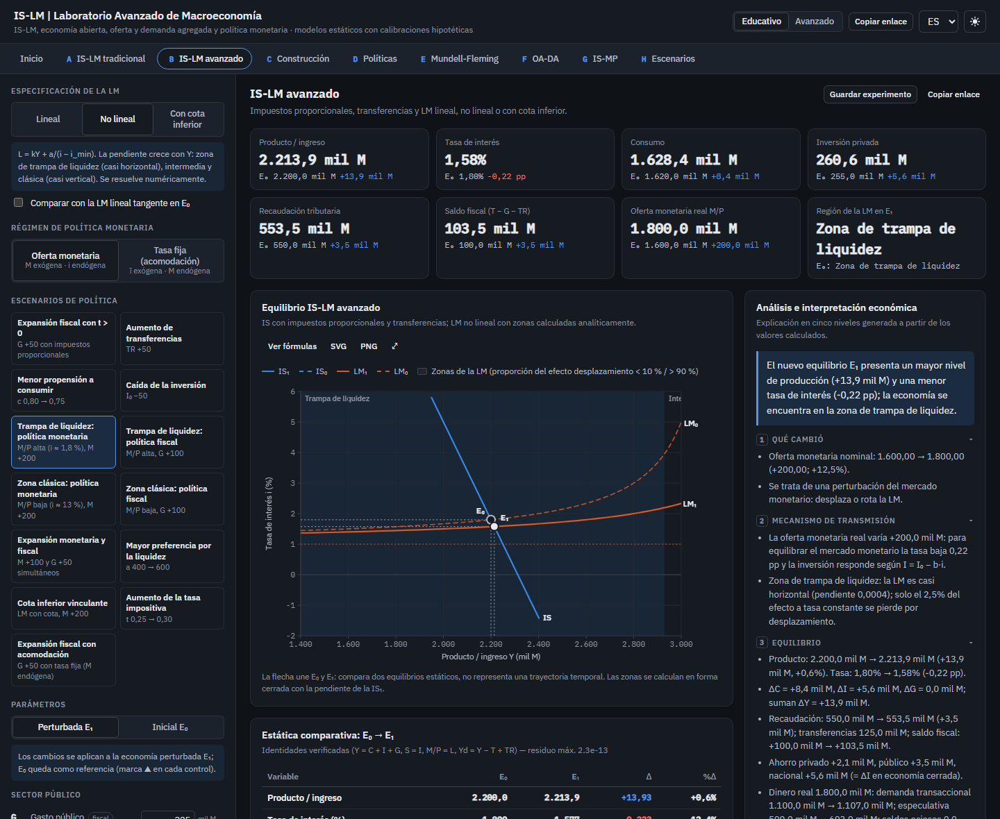
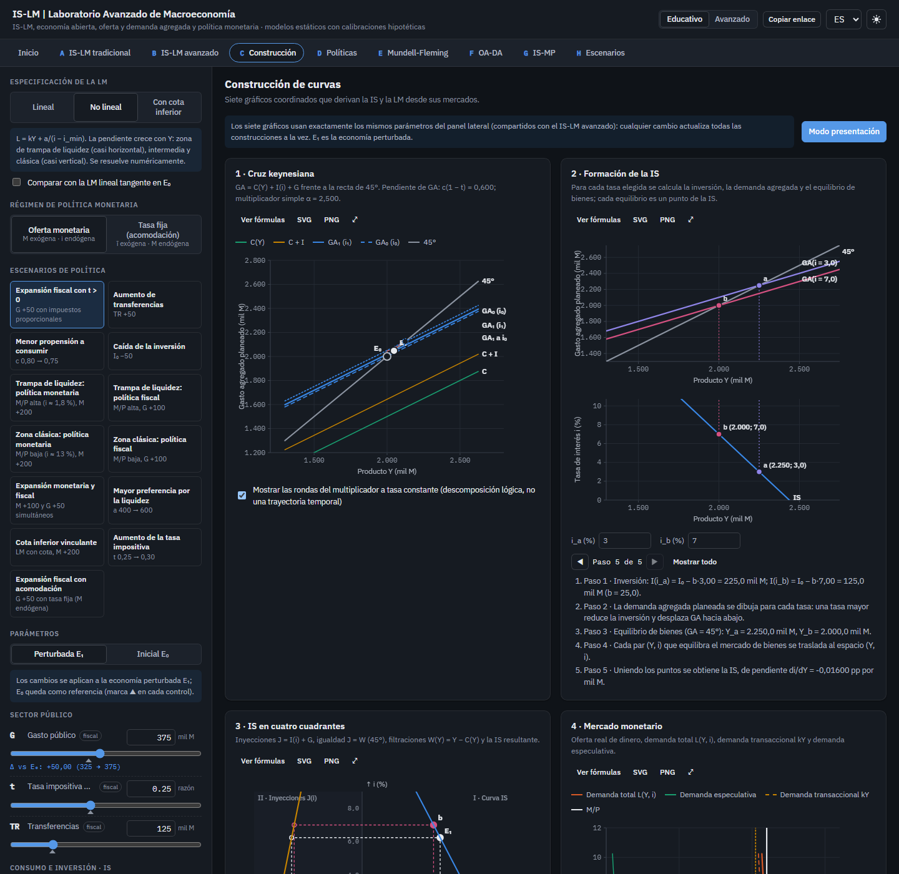
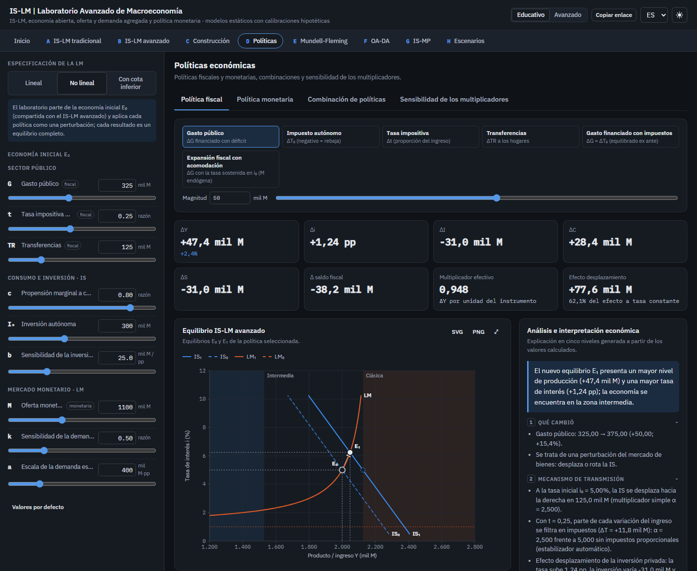
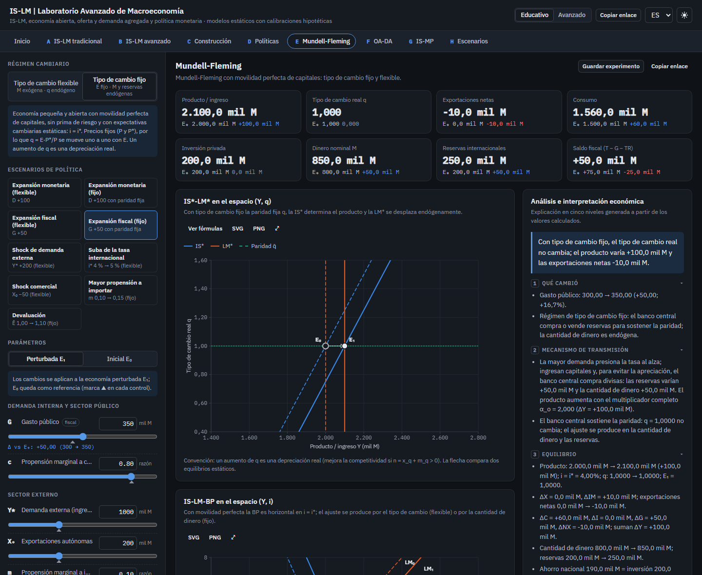
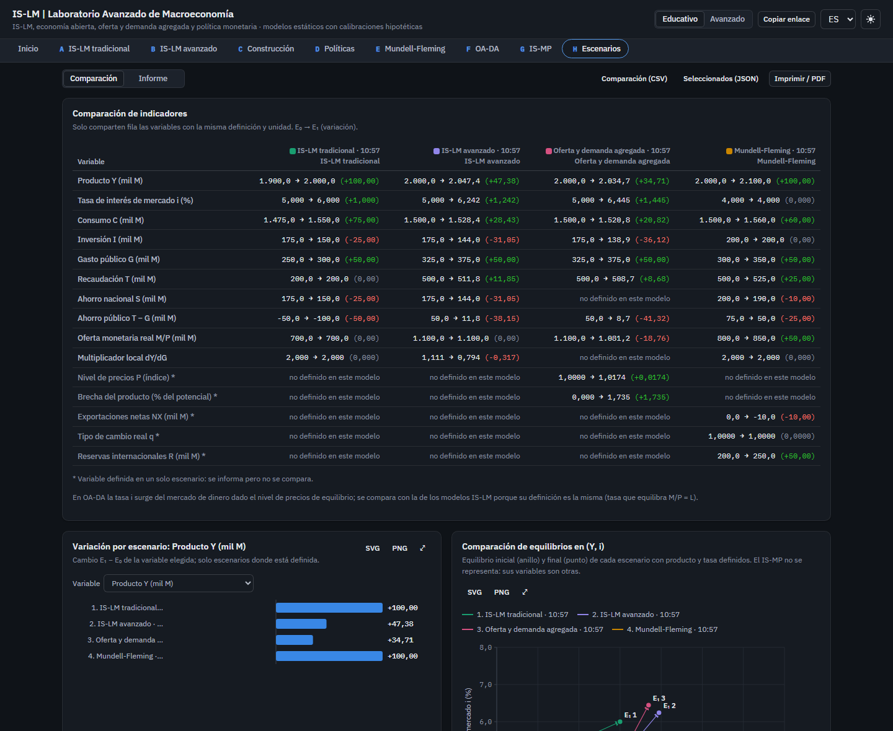
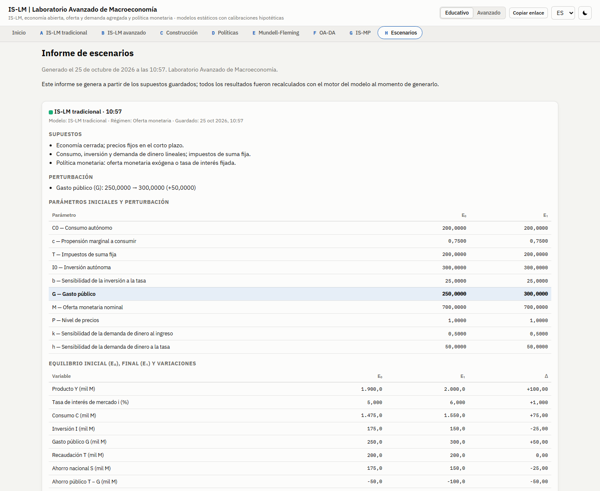

# IS-LM | Laboratorio Avanzado de Macroeconomía

Laboratorio interactivo de macroeconomía de corto y mediano plazo: IS-LM lineal y
no lineal, construcción gráfica de las curvas, políticas fiscal y monetaria,
Mundell-Fleming, oferta y demanda agregada, IS-MP con curva de Phillips y regla
de Taylor, y un laboratorio para guardar y comparar escenarios. Cada gráfico,
número y explicación se calcula a partir de las ecuaciones del modelo elegido.

**Aplicación publicada:** https://alanartola.github.io/islm-macroeconomic-simulator/
(se abre en español y en modo oscuro; el inglés y el tema claro están disponibles
en la barra superior)
 · **Documentación académica:** [docs/modelos](docs/modelos/README.md)
 · **English version:** [docs/README.en.md](docs/README.en.md)

[](https://github.com/alanartola/islm-macroeconomic-simulator/actions/workflows/ci-deploy.yml)


> **Alcance.** Modelos estáticos de libro de texto con **calibraciones
> hipotéticas** elegidas por claridad pedagógica. Ilustran mecanismos teóricos
> mediante estática comparativa; **no** son pronósticos ni recomendaciones de
> política para una economía real.

---

## Contenido

1. [Módulos](#módulos)
2. [Cómo se usa](#cómo-se-usa)
3. [Modelos y ecuaciones](#modelos-y-ecuaciones)
4. [Laboratorio de escenarios](#laboratorio-de-escenarios)
5. [Capturas](#capturas)
6. [Preferencias: idioma, tema y nivel](#preferencias-idioma-tema-y-nivel)
7. [Arquitectura](#arquitectura)
8. [Instalación y ejecución local](#instalación-y-ejecución-local)
9. [Validaciones y pruebas](#validaciones-y-pruebas)
10. [Limitaciones](#limitaciones)
11. [Bibliografía](#bibliografía)

---

## Módulos

| | Módulo | Contenido | Documentación |
|---|---|---|---|
| A | **IS-LM tradicional** | Modelo lineal con oferta monetaria exógena u objetivo de tasa; paneles de transmisión, sensibilidad, escenarios y modelo con KaTeX | [is-lm-tradicional](docs/modelos/is-lm-tradicional.md), [referencia completa](docs/MODELO.md) |
| B | **IS-LM avanzado** | Impuestos proporcionales, transferencias; LM lineal, no lineal (trampa de liquidez) o con cota inferior; zonas de la LM; diagnóstico del método numérico | [islm-avanzado](docs/modelos/islm-avanzado.md), [lm-no-lineal](docs/modelos/lm-no-lineal.md), [trampa-de-liquidez](docs/modelos/trampa-de-liquidez.md) |
| C | **Construcción de curvas** | Siete gráficos coordinados: cruz keynesiana, formación de la IS y la LM, IS y LM en cuatro cuadrantes, mercado monetario, equilibrio; modo presentación | [cuatro-cuadrantes](docs/modelos/cuatro-cuadrantes.md) |
| D | **Políticas económicas** | Política fiscal (G, T₀, t, TR, presupuesto equilibrado, acomodación), monetaria (M, tasa, preferencia por la liquidez, cota), matriz de combinaciones y sensibilidad de los multiplicadores | [politica-fiscal](docs/modelos/politica-fiscal.md), [politica-monetaria](docs/modelos/politica-monetaria.md), [multiplicadores](docs/modelos/multiplicadores.md) |
| E | **Mundell-Fleming** | Economía pequeña y abierta con movilidad perfecta de capitales; tipo de cambio fijo y flexible; reservas | [mundell-fleming](docs/modelos/mundell-fleming.md) |
| F | **Oferta y demanda agregada** | DA derivada del IS-LM, OA de corto plazo, mediano plazo y trayectoria de ajuste con expectativas adaptativas | [oa-da](docs/modelos/oa-da.md) |
| G | **IS-MP y política monetaria** | IS, curva de Phillips y regla de Taylor con cota inferior efectiva; tasa fija; sensibilidad a φπ y φy | [is-mp-taylor](docs/modelos/is-mp-taylor.md), [curva-de-phillips](docs/modelos/curva-de-phillips.md), [regla-de-taylor](docs/modelos/regla-de-taylor.md) |
| H | **Laboratorio de escenarios** | Guardar y comparar hasta cuatro escenarios, gráficos comparativos, curvas de sensibilidad, mapa de calor, CSV, JSON, importación, informe imprimible y enlaces | [escenarios](docs/modelos/escenarios.md), [sensibilidad](docs/modelos/sensibilidad.md) |

Métodos de solución y validación: [metodos-numericos](docs/modelos/metodos-numericos.md).

## Cómo se usa

1. Elegí un módulo y modificá los parámetros del panel lateral. **E₀** es la
   economía inicial y **E₁** la perturbada; los escenarios predefinidos aplican
   políticas o shocks típicos con un clic.
2. Leé la **explicación en cinco niveles**: (1) qué cambió, (2) mecanismo de
   transmisión, (3) equilibrio, (4) explicación matemática con los números del
   cálculo y (5) interpretación macroeconómica, que distingue *resultados del
   modelo*, *interpretaciones teóricas*, *posibles implicancias* y *advertencias*.
3. Guardá el experimento («Guardar experimento») o copiá un enlace que lo
   reabre exactamente; compará escenarios en el **Módulo H**.

Los gráficos se amplían, muestran sus fórmulas y se exportan en SVG o PNG. Las
flechas entre E₀ y E₁ comparan dos equilibrios estáticos: la única trayectoria
temporal del laboratorio es la del Módulo F, que se calcula con una regla
explícita de formación de expectativas.

## Modelos y ecuaciones

| Modelo | Ecuaciones principales | Solución |
|---|---|---|
| IS-LM tradicional | Y = C₀ + c(Y − T) + I₀ − b·i + G; M/P = kY − h·i | Cerrada (Cramer) |
| IS-LM avanzado | Y = α(A − b·i), α = 1/[1 − c(1 − t)]; M/P = kY + L₀ − h·i, o kY + a/(i − i_min), o con i ≥ i_piso | Cerrada o método de Brent |
| Mundell-Fleming | Y = α_o(A_o − b·i* + n·q); M/P = kY − h·i*; M = D + R | Cerrada según el régimen |
| OA-DA | Y = a₁ + a₂/P; P = Pᵉ + θ(Y − Yₙ) + s | Raíz positiva de una cuadrática |
| IS-MP | x = d − σ(i − πᵉ − rₙ); π = πᵉ + κx + u; i = r̂* + π + φπ(π − π*) + φy·x + v, i ≥ i_lb | Cerrada con rama de cota |

Ejemplos verificables a mano con las calibraciones por defecto:

- **A:** E₀ con Y = 1.900 e i = 5 %; G 250 → 300 da Y = 2.000, i = 6 % (la mitad
  del efecto keynesiano se pierde por desplazamiento de la inversión).
- **B:** E₀ con Y = 2.000 e i = 5 % en las tres especificaciones; G 325 → 375 con LM
  no lineal da Y = 2.047,38, i = 6,24 % (Brent, 7 iteraciones).
- **E:** G +50 con tipo flexible deja Y = 2.000 y aprecia q a 0,75; con tipo fijo
  Y = 2.100 y las reservas suben a 250.
- **F:** M 1.100 → 1.200 eleva P a 1,0338 en el corto plazo y a 1,0909 en el
  mediano plazo (neutralidad).
- **G:** un shock de demanda d = +2 deja una brecha de 1,03 con regla de Taylor y
  de 2 con tasa fija.

## Laboratorio de escenarios

- Un escenario guarda **solo supuestos**; todos los resultados se recalculan con
  el motor del modelo al comparar, exportar o imprimir.
- **Comparabilidad estricta:** solo comparten fila las variables con la misma
  definición y unidad. El producto en niveles y la tasa de los modelos IS-LM no
  se comparan con la brecha y la tasa de política del IS-MP; cuando una
  variable no existe en un modelo se indica «no definido en este modelo».
- **Gráficos:** variación por escenario, comparación de equilibrios en (Y, i),
  curvas de sensibilidad superpuestas y mapa de calor de dos parámetros.
- **Exportación:** CSV de la comparación, JSON de escenarios (con importación
  validada), PNG y SVG de cada gráfico, e **informe imprimible / PDF** con modelo,
  fecha, supuestos, parámetros, perturbación, E₀, E₁, variaciones, explicación,
  ecuaciones y limitaciones.
- **Enlaces:** `?m=<módulo>#x=<configuración>` reabre una configuración en su módulo.

## Capturas

| | |
|---|---|
|  |  |
|  |  |
|  |  |
|  |  |
|  |  |
|  |  |

<p align="center"></p>

Las capturas se generan con `node scripts/screenshots.mjs` a partir de un
almacenamiento local vacío, es decir, con las preferencias de una primera visita.

## Preferencias: idioma, tema y nivel

- **Idioma:** español en toda primera visita. El inglés se usa solo si el enlace
  lo pide (`?lang=en`) o si se eligió en el selector (preferencia guardada). El
  idioma del navegador no se tiene en cuenta.
- **Tema:** **oscuro** en toda primera visita, independientemente de la
  configuración del sistema operativo. La elección explícita (claro u oscuro) se
  guarda y se respeta en las recargas. Un script en `index.html` aplica el tema
  antes de pintar la página, por lo que no hay destello de tema incorrecto.
  `?theme=light|dark` cambia el tema de esa visita sin sobrescribir la
  preferencia guardada.
- **Nivel:** *educativo* (variables esenciales, explicaciones paso a paso) o
  *avanzado* (todos los parámetros, derivadas, elasticidades y diagnósticos).
- **Pantalla inicial:** la primera visita abre la pantalla de inicio; luego se
  recuerda el último módulo. `?m=basic|advanced|construction|policy|open|adas|ismp|lab|home` abre un módulo.

## Arquitectura

```
src/
├── engine/              Motores económicos puros (sin React)
│   ├── islm.ts, comparative.ts, sensitivity.ts, validation.ts   Módulo A
│   ├── advanced/        Módulo B (modelo, construcción de curvas, políticas)
│   ├── numeric/         método de Brent y bisección
│   ├── open/            Mundell-Fleming
│   ├── adas/            oferta y demanda agregada
│   └── ismp/            IS-MP, curva de Phillips, regla de Taylor
├── interpretation/      explicaciones en cinco niveles (claves de traducción + valores calculados)
├── lab/                 escenarios: validación, indicadores comparables, CSV/JSON, enlaces, exportadores
├── modules/             vistas de cada módulo (home, basic, advanced, construction, policy, open, adas, ismp, lab)
├── components/          gráficos SVG (d3-scale/d3-shape), tarjetas, paneles de parámetros
├── state/               estado de los módulos, preferencias, laboratorio
├── i18n/                diccionarios ES (principal) y EN con paridad verificada por pruebas
└── styles/              tokens de diseño (oscuro predeterminado, claro, impresión)
```

- **Tecnologías:** React 19, TypeScript estricto, Vite 7, d3-scale / d3-shape,
  KaTeX (carga diferida), Vitest + Testing Library, ESLint, GitHub Actions,
  GitHub Pages.
- Los motores nunca devuelven números no finitos ni resultados sin sentido
  económico: devuelven `{ ok: false, issues }` y la interfaz muestra el
  diagnóstico.
- Sin servidores ni servicios externos: los escenarios se guardan en el
  navegador y los archivos se generan en el cliente.

## Instalación y ejecución local

Requisitos: Node.js ≥ 20 y npm.

```bash
git clone https://github.com/alanartola/islm-macroeconomic-simulator.git
cd islm-macroeconomic-simulator
npm ci
npm run dev
```

| Script | Función |
|---|---|
| `npm run dev` | servidor de desarrollo |
| `npm test` | pruebas unitarias, de regresión y de integración |
| `npm run typecheck` / `npm run lint` | verificaciones estáticas |
| `npm run build` | compilación de producción en `dist/` (ruta base `/islm-macroeconomic-simulator/`) |
| `npm run validate` | typecheck + lint + pruebas + build (igual que en CI) |
| `node scripts/screenshots.mjs` | regenera las capturas a partir del servidor de desarrollo |

## Validaciones y pruebas

369 pruebas automáticas (Vitest) cubren, entre otros aspectos:

- **Motores** frente a soluciones calculadas a mano en los cinco modelos;
  identidades contables y residuos; derivadas analíticas frente a diferencias
  finitas; unicidad del equilibrio con LM no lineal; casos límite (h = 0, b = 0,
  trampa, zona clásica, cota inferior, cota efectiva del IS-MP, reservas
  agotadas, raíz positiva de la OA-DA).
- **Método de Brent y bisección**: convergencia, intervalos inválidos,
  funciones no finitas.
- **Explicaciones**: cada afirmación coincide con la comparación calculada, sin
  marcadores sin resolver, en español e inglés; las variaciones porcentuales
  desde un valor inicial nulo no se informan.
- **Laboratorio**: resultados recalculados, comparabilidad entre modelos, CSV,
  ida y vuelta de JSON y de enlaces, rechazo de archivos inválidos, límite de
  cuatro escenarios, informe.
- **Interfaz**: navegación A–H, pantalla de inicio, español y modo oscuro por
  defecto, persistencia de idioma y tema, modos educativo y avanzado.

GitHub Actions ejecuta typecheck, lint, pruebas y compilación en cada push y
pull request, y publica `main` en GitHub Pages solo si todo se aprueba.

## Limitaciones

- Modelos **estáticos**: comparan equilibrios; solo el Módulo F incluye una
  trayectoria, con expectativas adaptativas simples.
- Precios fijos en A, B, C, D y E; expectativas exógenas en F (corto plazo) y G.
- Mundell-Fleming solo con movilidad perfecta de capitales, sin prima de riesgo
  ni efectos de balance.
- El IS-MP no es un modelo neokeynesiano con optimización intertemporal.
- Calibraciones hipotéticas; los coeficientes no son invariantes a la política
  (crítica de Lucas). Los resultados son ilustraciones, no predicciones.

Posibles extensiones: movilidad imperfecta de capitales (BP con pendiente),
dinámica de inflación con expectativas endógenas, deuda pública y una versión
prospectiva del modelo de tres ecuaciones.

## Bibliografía

Referencias con DOI verificadas contra los registros de Crossref; Friedman
(1968) no tiene DOI. Lista completa en [docs/modelos](docs/modelos/README.md#bibliografía-verificada).

- Blanchard, O. (2021). *Macroeconomics* (8.ª ed.). Pearson.
- Brent, R. P. (1973). *Algorithms for Minimization without Derivatives*. Prentice-Hall.
- Carlin, W., y Soskice, D. (2015). *Macroeconomics: Institutions, Instability, and the Financial System*. Oxford University Press.
- Clarida, R., Galí, J., y Gertler, M. (1999). The Science of Monetary Policy: A New Keynesian Perspective. *Journal of Economic Literature*, 37(4), 1661–1707. https://doi.org/10.1257/jel.37.4.1661
- Fleming, J. M. (1962). Domestic Financial Policies under Fixed and under Floating Exchange Rates. *IMF Staff Papers*, 9(3), 369–380. https://doi.org/10.2307/3866091
- Friedman, M. (1968). The Role of Monetary Policy. *American Economic Review*, 58(1), 1–17.
- Hicks, J. R. (1937). Mr. Keynes and the "Classics"; A Suggested Interpretation. *Econometrica*, 5(2), 147–159. https://doi.org/10.2307/1907242
- Keynes, J. M. (1936). *The General Theory of Employment, Interest and Money*. Macmillan.
- Krugman, P. R. (1998). It's Baaack: Japan's Slump and the Return of the Liquidity Trap. *Brookings Papers on Economic Activity*, 1998(2), 137–205. https://doi.org/10.2307/2534694
- Mankiw, N. G. (2019). *Macroeconomics* (10.ª ed.). Worth Publishers.
- Mundell, R. A. (1963). Capital Mobility and Stabilization Policy under Fixed and Flexible Exchange Rates. *Canadian Journal of Economics and Political Science*, 29(4), 475–485. https://doi.org/10.2307/139336
- Phelps, E. S. (1967). Phillips Curves, Expectations of Inflation and Optimal Unemployment over Time. *Economica*, 34(135), 254–281. https://doi.org/10.2307/2552025
- Phillips, A. W. (1958). The Relation between Unemployment and the Rate of Change of Money Wage Rates in the United Kingdom, 1861–1957. *Economica*, 25(100), 283–299. https://doi.org/10.1111/j.1468-0335.1958.tb00003.x
- Poole, W. (1970). Optimal Choice of Monetary Policy Instruments in a Simple Stochastic Macro Model. *Quarterly Journal of Economics*, 84(2), 197–216. https://doi.org/10.2307/1883009
- Romer, D. (2000). Keynesian Macroeconomics without the LM Curve. *Journal of Economic Perspectives*, 14(2), 149–169. https://doi.org/10.1257/jep.14.2.149
- Taylor, J. B. (1993). Discretion versus Policy Rules in Practice. *Carnegie-Rochester Conference Series on Public Policy*, 39, 195–214. https://doi.org/10.1016/0167-2231(93)90009-L

## Licencia

[MIT](LICENSE)
