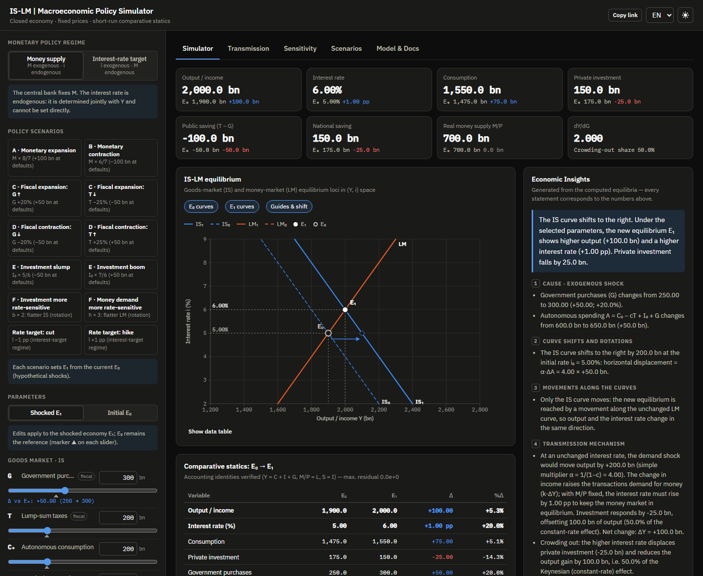
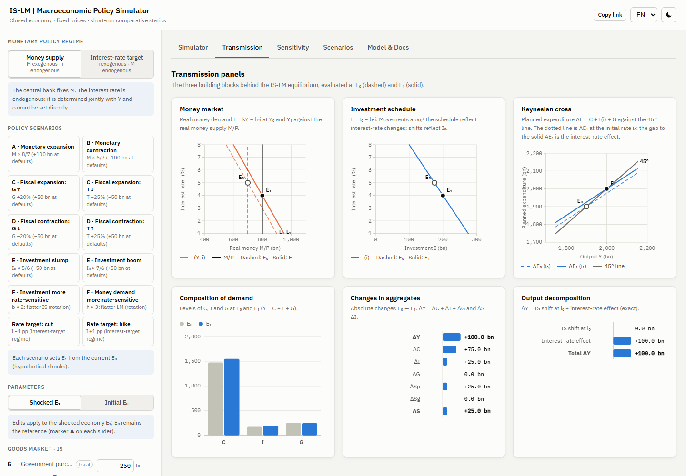

# IS-LM | Macroeconomic Policy Simulator

An interactive macroeconomic simulation platform for exploring IS-LM equilibrium, monetary and fiscal policy transmission, interest rate dynamics, and comparative statics through mathematical modeling and real-time visualizations.

> English translation of the main documentation. The primary documentation and the default interface language are **Spanish**: see the [main README](../README.md).

**Live application:** https://alanartola.github.io/islm-macroeconomic-simulator/?lang=en (English interface; the default link opens in Spanish)
 · **Model reference:** [MODEL.en.md](MODEL.en.md)

[](https://github.com/alanartola/islm-macroeconomic-simulator/actions/workflows/ci-deploy.yml)



> **Scope.** The application implements the textbook short-run IS-LM model of a closed economy with a fixed price level. Default values are a **hypothetical calibration** chosen for pedagogical clarity. The tool illustrates comparative statics; it is **not** a forecasting system for any real economy.

---

## Contents

1. [What the application does](#what-the-application-does)
2. [The model](#the-model)
3. [Monetary policy regimes](#monetary-policy-regimes)
4. [Features](#features)
5. [Example simulations](#example-simulations)
6. [Architecture](#architecture)
7. [Running locally](#running-locally)
8. [Validation and tests](#validation-and-tests)
9. [Limitations](#limitations)
10. [Bibliography](#bibliography)

---

## What the application does

The simulator compares two equilibria of the same economy:

- **E₀ — initial economy**, defined by a set of exogenous parameters;
- **E₁ — shocked economy**, obtained by changing one or more parameters (a policy or a behavioural shock).

For every change it recomputes, analytically and instantly, the interest rate, output, consumption, investment, government purchases, tax revenue, disposable income, real money supply and demand, private/public/national saving, the policy multipliers, the shifts of both curves and the absolute and percentage variations. An **Economic Insights** panel then explains the result — distinguishing *causes*, *curve shifts*, *movements along curves*, *transmission mechanisms* and *effects on endogenous variables* — using only the numbers actually computed.

## The model

### Structural equations

| Block | Equation | Restrictions |
|---|---|---|
| Goods-market equilibrium | Y = C + I + G | — |
| Consumption | C = C₀ + c(Y − T) | 0 ≤ c < 1 |
| Investment | I = I₀ − b·i | b ≥ 0 |
| Money-market equilibrium | M/P = kY − h·i | k > 0, h ≥ 0, P > 0 |

### Dimensional conventions

Flows (Y, C, I, G, T, C₀, I₀) and money (M, M/P) are measured in **billions of currency units (bn)**; the interest rate **i is in percentage points** (i = 5 ⇒ 5%); therefore **b and h are in bn per percentage point**, c and k are dimensionless and P is an index (base 1). Every equation is dimensionally homogeneous; automated tests check scale invariance and the change of rate unit (pp → decimal with b, h × 100).

### IS and LM curves

With autonomous spending **A ≡ C₀ − cT + I₀ + G**, the simple multiplier **α ≡ 1/(1 − c)** and real balances **m ≡ M/P**:

```
IS:  Y = α (A − b·i)        ⇔  i = [A − (1 − c) Y] / b        slope di/dY = −(1 − c)/b
LM:  Y = (m + h·i) / k      ⇔  i = (kY − m) / h               slope di/dY =  k/h
```

### Equilibrium (money-supply regime)

With the system determinant **D ≡ h(1 − c) + b·k > 0**:

```
Y* = (h·A + b·m) / D
i* = (k·A − (1 − c)·m) / D
```

The default calibration (C₀ = 200, c = 0.75, T = 200, I₀ = 300, b = 25, G = 250, M = 700, P = 1, k = 0.5, h = 50) gives A = 600, D = 25, **Y\* = 1,900** and **i\* = 5%** — a hand-checkable regression case.

### Multipliers

| Multiplier | Money-supply regime | Interest-target regime |
|---|---|---|
| dY/dG = dY/dI₀ = dY/dC₀ | h/D | 1/(1 − c) |
| dY/dT | −c·h/D | −c/(1 − c) |
| Balanced budget (dT = dG) | (1 − c)·h/D | 1 |
| dY/d(M/P) | b/D | — (M is endogenous) |
| di/dG | k/D | 0 |
| di/d(M/P) | −(1 − c)/D | — |
| dY/dī | — | −b/(1 − c) |
| Crowding-out share | b·k/D | 0 |

### Crowding out — exact decomposition

For any change E₀ → E₁ the application reports

```
ΔY = [Y_IS₁(i₀) − Y₀]  +  [−α₁·b₁·Δi]
      IS shift at i₀       interest-rate effect (crowding out / crowding in)
```

and ΔI = ΔI₀ − Δb·i₀ − b₁·Δi, ΔL = k₁ΔY − h₁Δi + (Δk·Y₀ − Δh·i₀). These identities hold exactly and are tested.

The full derivations, parameter restrictions and limiting cases are in **[MODEL.en.md](MODEL.en.md)** and in the in-app *Model & Docs* tab (rendered with KaTeX and evaluated at the current parameters).

## Monetary policy regimes

The interest rate is endogenous in the traditional IS-LM model. The application therefore never lets the user "set" an endogenous rate while keeping its determinants unchanged. Instead it offers two explicit regimes:

| | Mode 1 — Money supply (traditional IS-LM) | Mode 2 — Interest-rate target |
|---|---|---|
| Instrument | M (exogenous) | ī (exogenous) |
| Endogenous | Y, **i** | Y, **M = P·(kY − h·ī)** |
| LM curve | upward-sloping, i = (kY − m)/h | horizontal at i = ī |
| Fiscal shock | partially crowded out | full Keynesian effect, M accommodates |
| How i changes | only via M, P, G, T, … | the central bank moves ī |

Switching to Mode 2 pegs ī at the current initial equilibrium rate, so E₀ is unchanged by the switch itself. Under Mode 2 the insights include a **counterfactual**: the same shock with M frozen at M₀ (Mode 1). A target is rejected as infeasible if it would require a non-positive money stock.

## Features

- **Central IS-LM chart** (custom SVG on d3-scale/d3-shape): IS₀/LM₀ dashed and IS₁/LM₁ solid, E₀ and E₁, guides, shift arrows at i₀, the constant-rate (Keynesian) point, crosshair tooltips with exact values, toggles for initial/new curves and guides, saved-scenario overlays and an accessible data table.
- **Parameter panel** with sliders and free numeric inputs for E₁ or E₀, reference markers (▲) of E₀ and deltas. Unshocked parameters of E₁ follow recalibrations of E₀.
- **Scenarios A–F**: monetary expansion and contraction; fiscal expansion and contraction via G or T; positive and negative autonomous-investment shocks; higher b (flatter IS) and higher h (flatter LM); plus policy-rate cut/hike under Mode 2.
- **Indicators**: KPI cards, full comparative-statics table (levels, Δ, %Δ), multiplier table for E₀ and E₁, live verification of the accounting identities.
- **Transmission panels**: money market (L vs M/P), investment schedule, Keynesian cross with AE₁ at i₀, composition of demand, changes in aggregates and the exact output decomposition.
- **Sensitivity (scenario F)**: fiscal and monetary multipliers as functions of b and h, and a grid of the output effect of the same policy for alternative slopes.
- **Saved scenarios**: save, reload, delete and compare experiments within the browser session; show/hide them on the chart.
- **Validation**: invalid inputs (c ≥ 1, k ≤ 0, b = h = 0, non-finite values, infeasible targets…) are reported as errors and never computed silently; implausible but admissible cases (negative rate or investment, very high c, liquidity-trap region) are flagged.
- **Spanish (default) / English** interface, **light / dark** themes, responsive layout, shareable links (`#s=` encodes only model inputs).



More screenshots (Spanish interface, the default) are in the [main README](../README.md#capturas).

## Example simulations

All figures use the default hypothetical calibration (Y₀ = 1,900 bn, i₀ = 5%). They are regression cases in the test-suite.

| Scenario | Shock | ΔY | Δi | ΔI | Reading |
|---|---|---|---|---|---|
| A · Monetary expansion | M 700 → 800 | +100 | −1.00 pp | +25 | LM shifts right by Δm/k = 200; movement along the IS |
| B · Monetary contraction | M 700 → 600 | −100 | +1.00 pp | −25 | LM shifts left |
| C · Fiscal expansion (G) | G 250 → 300 | +100 | +1.00 pp | −25 | IS shifts right by αΔG = 200; half is crowded out (b·k/D = 50%) |
| C · Fiscal expansion (T) | T 200 → 150 | +75 | +0.75 pp | −18.75 | Smaller than ΔG: a share (1 − c) of the tax cut is saved |
| D · Fiscal contraction (G) | G 250 → 200 | −100 | −1.00 pp | +25 | Crowding in |
| E · Investment slump | I₀ 300 → 250 | −100 | −1.00 pp | −25 | The rate fall cushions the shock |
| C under Mode 2 | G 250 → 300, ī = 5% | +200 | 0 | 0 | Full Keynesian effect; M rises by 100 |
| Rate cut under Mode 2 | ī 5% → 4% | +100 | −1.00 pp | +25 | dY/dī = −αb = −100; M rises by 100 |

## Architecture

```
src/
├── engine/            Pure, UI-independent economic engine (no React)
│   ├── types.ts           parameters, equilibrium, multipliers, issues
│   ├── validation.ts      input restrictions → machine-readable errors/warnings
│   ├── islm.ts            curves, closed-form solution, multipliers, identities
│   ├── comparative.ts     E₀ → E₁ changes, curve shifts, exact decompositions
│   ├── sensitivity.ts     multiplier profiles in b and h
│   └── curves.ts, defaults.ts
├── interpretation/    Economic Insights generator (language-independent keys + numbers)
├── state/             reducer, presets A–F, parameter metadata, share links, session storage
├── i18n/              EN/ES dictionaries, locale-aware number formatting
├── components/        React views and SVG charts (IS-LM, panels, bars, sensitivity)
└── styles/            design tokens (light/dark), layout
```

- **Stack:** React 19, TypeScript (strict), Vite 7, d3-scale / d3-shape, KaTeX (lazy-loaded), Vitest + Testing Library, ESLint, GitHub Actions, GitHub Pages.
- The engine never returns non-finite numbers: degenerate inputs yield `{ ok: false, issues }`.
- Insight texts are templates filled with computed values, so every statement corresponds to the displayed results in both languages.
- No backend, paid service or private API is used.

## Running locally

Requirements: Node.js ≥ 20 and npm.

```bash
git clone https://github.com/alanartola/islm-macroeconomic-simulator.git
cd islm-macroeconomic-simulator
npm ci
npm run dev          # http://localhost:5173
```

| Script | Purpose |
|---|---|
| `npm run dev` | development server |
| `npm test` | unit, regression and integration tests |
| `npm run coverage` | tests with coverage of engine, interpretation and state |
| `npm run typecheck` / `npm run lint` | static checks |
| `npm run build` | production build into `dist/` (base path `/islm-macroeconomic-simulator/`) |
| `npm run validate` | typecheck + lint + tests + build (same as CI) |
| `node scripts/screenshots.mjs` | regenerate README screenshots from a running dev server |

URL parameters: `?lang=en|es` (Spanish is the default when absent), `?theme=light|dark`, `?tab=simulator|transmission|sensitivity|scenarios|model`, and `#s=…` share links.

## Validation and tests

The test-suite (Vitest) covers:

- **Equilibrium resolution** against hand-computed analytical solutions (including P ≠ 1, fractional solutions, h = 0 and b = 0).
- **Accounting identities**: Y = C + I + G, M/P = kY − h·i, S = S_p + S_g = I, Y − T = C + S_p.
- **Policy signs and magnitudes**: monetary expansion/contraction, fiscal expansion/contraction via G and T, autonomous-investment shocks.
- **Multipliers** against finite differences of the solved model; fiscal multiplier bounded by the Keynesian multiplier.
- **Interest sensitivity**: effect of b and h on slopes and on policy effectiveness; limits h → 0, h → ∞, b → 0.
- **Interest-target regime**: rate held at ī, endogenous M, full Keynesian effect, consistency with Mode 1 when ī = i\*, infeasible targets.
- **Dimensional coherence**: homogeneity of degree 1 in bn quantities, invariance to the rate unit, neutrality of equiproportional M and P.
- **Invalid and extreme inputs**: non-finite values, c ≥ 1, negative sensitivities, k ≤ 0, P ≤ 0, b = h = 0, non-positive output; no non-finite outputs for extreme valid inputs.
- **Exactness of variations** (absolute and percentage, zero base handled) and of the output, investment and money-demand decompositions.
- **Interpretation**: every insight matches the computed comparison and renders without unresolved placeholders in EN and ES.
- **State, share links, translation parity and UI integration**.

GitHub Actions runs typecheck, lint, tests and the production build on every push and pull request, and deploys `main` to GitHub Pages only when all checks pass.

## Limitations

- Closed economy, fixed price level, no aggregate supply, inflation or expectations; nominal and real rates coincide.
- Linear behavioural functions with constant coefficients and lump-sum taxes (no income tax rate).
- Static comparative statics: no adjustment dynamics or stability analysis.
- A single interest rate; no banking sector, risk premia, term structure or effective-lower-bound mechanics (negative rates are flagged, not prevented).
- The interest-target regime is a static approximation of interest-rate rules used in New Keynesian models; it ignores determinacy issues of pure pegs under flexible prices.
- Behavioural coefficients are not policy-invariant (Lucas critique); results are qualitative illustrations, not predictions.

Possible extensions: proportional income taxes (automatic stabilisers), an open-economy Mundell-Fleming module, an AD-AS block with price adjustment, a Taylor-type rule, and dynamic adjustment paths.

## Bibliography

- Blanchard, O. (2021). *Macroeconomics* (8th ed.). Pearson.
- Dornbusch, R., Fischer, S., & Startz, R. (2014). *Macroeconomics* (12th ed.). McGraw-Hill Education.
- Galí, J. (2015). *Monetary Policy, Inflation, and the Business Cycle* (2nd ed.). Princeton University Press.
- Hansen, A. H. (1953). *A Guide to Keynes*. McGraw-Hill.
- Hicks, J. R. (1937). Mr. Keynes and the "Classics"; A Suggested Interpretation. *Econometrica*, 5(2), 147–159. https://doi.org/10.2307/1907242
- Keynes, J. M. (1936). *The General Theory of Employment, Interest and Money*. Macmillan.
- Krugman, P. R. (1998). It's Baaack: Japan's Slump and the Return of the Liquidity Trap. *Brookings Papers on Economic Activity*, 1998(2), 137–205. https://doi.org/10.2307/2534694
- Mankiw, N. G. (2019). *Macroeconomics* (10th ed.). Worth Publishers.
- Poole, W. (1970). Optimal Choice of Monetary Policy Instruments in a Simple Stochastic Macro Model. *Quarterly Journal of Economics*, 84(2), 197–216. https://doi.org/10.2307/1883009
- Romer, D. (2000). Keynesian Macroeconomics without the LM Curve. *Journal of Economic Perspectives*, 14(2), 149–169. https://doi.org/10.1257/jep.14.2.149
- Sargent, T. J., & Wallace, N. (1975). "Rational" Expectations, the Optimal Monetary Instrument, and the Optimal Money Supply Rule. *Journal of Political Economy*, 83(2), 241–254. https://doi.org/10.1086/260321
- Taylor, J. B. (1993). Discretion versus Policy Rules in Practice. *Carnegie-Rochester Conference Series on Public Policy*, 39, 195–214. https://doi.org/10.1016/0167-2231(93)90009-L
- Woodford, M. (2003). *Interest and Prices: Foundations of a Theory of Monetary Policy*. Princeton University Press.

## License

[MIT](../LICENSE)
