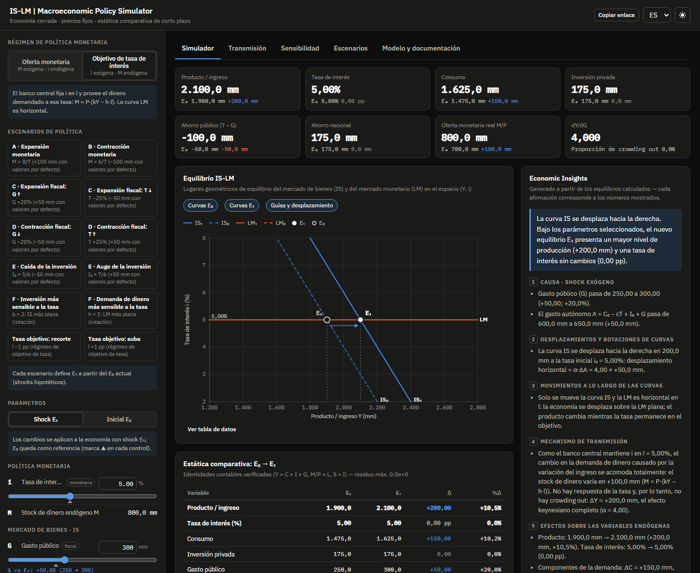

# IS-LM | Macroeconomic Policy Simulator — Documentación en español

Plataforma interactiva de simulación macroeconómica para estudiar el equilibrio IS-LM, la transmisión de las políticas monetaria y fiscal, la dinámica de la tasa de interés y la estática comparativa mediante modelización matemática y visualizaciones en tiempo real.

**Aplicación publicada:** https://alanartola.github.io/islm-macroeconomic-simulator/ (selector de idioma EN/ES en la barra superior, o `?lang=es`).
**Documentación principal (inglés):** [README.md](../README.md) · **Referencia del modelo:** [MODEL.md](MODEL.md)



> **Alcance.** La aplicación implementa el modelo IS-LM de corto plazo de libro de texto para una economía cerrada con nivel de precios fijo. Los valores por defecto son una **calibración hipotética** elegida por claridad pedagógica. La herramienta ilustra estática comparativa; **no** es un sistema de predicción de ninguna economía real.

## 1. Qué hace

El simulador compara dos equilibrios de la misma economía: **E₀** (economía inicial) y **E₁** (economía con shock). Ante cada cambio recalcula analíticamente la tasa de interés, el producto, el consumo, la inversión, el gasto público, la recaudación, el ingreso disponible, la oferta y la demanda reales de dinero, el ahorro privado, público y nacional, los multiplicadores, los desplazamientos de las curvas y las variaciones absolutas y porcentuales. La sección **Economic Insights** explica el resultado separando causas, desplazamientos de curvas, movimientos a lo largo de las curvas, mecanismos de transmisión y efectos sobre las variables endógenas, siempre con los valores efectivamente calculados.

## 2. Modelo

| Bloque | Ecuación |
|---|---|
| Equilibrio del mercado de bienes | Y = C + I + G |
| Consumo | C = C₀ + c(Y − T), 0 ≤ c < 1 |
| Inversión | I = I₀ − b·i, b ≥ 0 |
| Equilibrio monetario | M/P = kY − h·i, k > 0, h ≥ 0 |

**Unidades:** flujos y dinero en miles de millones de unidades monetarias (mm); i en puntos porcentuales; b y h en mm por punto porcentual; c y k adimensionales; P índice.

Con A ≡ C₀ − cT + I₀ + G, α ≡ 1/(1 − c), m ≡ M/P y D ≡ h(1 − c) + b·k:

```
IS:  Y = α (A − b·i)            pendiente −(1 − c)/b
LM:  Y = (m + h·i)/k            pendiente  k/h
Y* = (h·A + b·m)/D              i* = (k·A − (1 − c)·m)/D
```

Multiplicadores (régimen de oferta monetaria): dY/dG = h/D, dY/dT = −c·h/D, dY/d(M/P) = b/D, di/dG = k/D, di/d(M/P) = −(1 − c)/D; proporción de crowding out = b·k/D.

Con la calibración por defecto se obtiene A = 600, D = 25, **Y\* = 1.900** e **i\* = 5%**.

## 3. Regímenes de política monetaria

- **Modo 1 — IS-LM tradicional:** el banco central fija M y la tasa es endógena. La aplicación no permite modificar la tasa directamente manteniendo sus determinantes: para cambiarla hay que modificar M, P, G, T u otros parámetros.
- **Modo 2 — Objetivo de tasa:** el banco central fija ī y provee el dinero demandado, M = P·(kY − h·ī); la LM es horizontal. Los shocks de demanda tienen el efecto keynesiano completo y el dinero se ajusta endógenamente. Al activar el modo, ī se fija en la tasa de equilibrio inicial, de modo que E₀ no cambia. Se informa además el contrafáctico con M fija en M₀.

## 4. Funcionalidades

- Gráfico IS-LM central con curvas iniciales (discontinuas) y nuevas (continuas), E₀ y E₁, guías, flechas de desplazamiento, punto a tasa constante, tooltips con valores exactos, escenarios guardados superpuestos y tabla de datos accesible.
- Panel de parámetros para E₁ o E₀ con controles deslizantes, entradas numéricas libres, marcas de referencia y variaciones.
- Escenarios A–F: expansión y contracción monetaria; expansión y contracción fiscal vía G o T; shocks de inversión autónoma; mayor b (IS más plana) y mayor h (LM más plana); recorte y suba de la tasa objetivo.
- Indicadores, tabla de estática comparativa, multiplicadores y verificación en vivo de las identidades contables.
- Paneles de transmisión: mercado monetario, función de inversión, cruz keynesiana, composición de la demanda, variaciones y descomposición exacta del producto.
- Análisis de sensibilidad de los multiplicadores respecto de b y h.
- Guardado y comparación de escenarios durante la sesión.
- Interfaz en inglés y español, temas claro y oscuro, diseño adaptable y enlaces para compartir.

## 5. Ejemplos (calibración por defecto)

| Escenario | Shock | ΔY | Δi | ΔI |
|---|---|---|---|---|
| A · Expansión monetaria | M 700 → 800 | +100 | −1,00 pp | +25 |
| C · Expansión fiscal (G) | G 250 → 300 | +100 | +1,00 pp | −25 (crowding out del 50%) |
| C · Expansión fiscal (T) | T 200 → 150 | +75 | +0,75 pp | −18,75 |
| E · Caída de la inversión | I₀ 300 → 250 | −100 | −1,00 pp | −25 |
| C con objetivo de tasa | G 250 → 300, ī = 5% | +200 | 0 | 0 (M sube 100) |

## 6. Ejecución local

```bash
git clone https://github.com/alanartola/islm-macroeconomic-simulator.git
cd islm-macroeconomic-simulator
npm ci
npm run dev        # http://localhost:5173
npm run validate   # typecheck + lint + tests + build
```

## 7. Pruebas

Los tests automáticos (Vitest) verifican la resolución del equilibrio contra soluciones analíticas, las identidades contables, los efectos esperados de las expansiones monetaria y fiscal, la sensibilidad de la inversión a la tasa, la consistencia del régimen de tasa objetivo, el tratamiento de parámetros extremos y entradas inválidas, la coherencia dimensional, la exactitud de las variaciones, la interpretación automática (en ambos idiomas) y la integración de la interfaz. GitHub Actions ejecuta todas las validaciones y publica en GitHub Pages solo si se aprueban.

## 8. Limitaciones

Economía cerrada, precios fijos, sin expectativas ni inflación; funciones lineales e impuestos de suma fija; estática comparativa sin dinámica de ajuste; una única tasa de interés y sin sector bancario; la cota inferior de la tasa solo se señala. El Modo 2 es una aproximación estática a las reglas de tasa de los modelos neokeynesianos. Los resultados son ilustraciones cualitativas, no predicciones.

## 9. Bibliografía

Ver la sección [Bibliography](../README.md#bibliography) del README principal (Hicks, 1937; Keynes, 1936; Hansen, 1953; Poole, 1970; Sargent y Wallace, 1975; Taylor, 1993; Krugman, 1998; Romer, 2000; Woodford, 2003; Galí, 2015; Blanchard, 2021; Mankiw, 2019; Dornbusch, Fischer y Startz, 2014).
